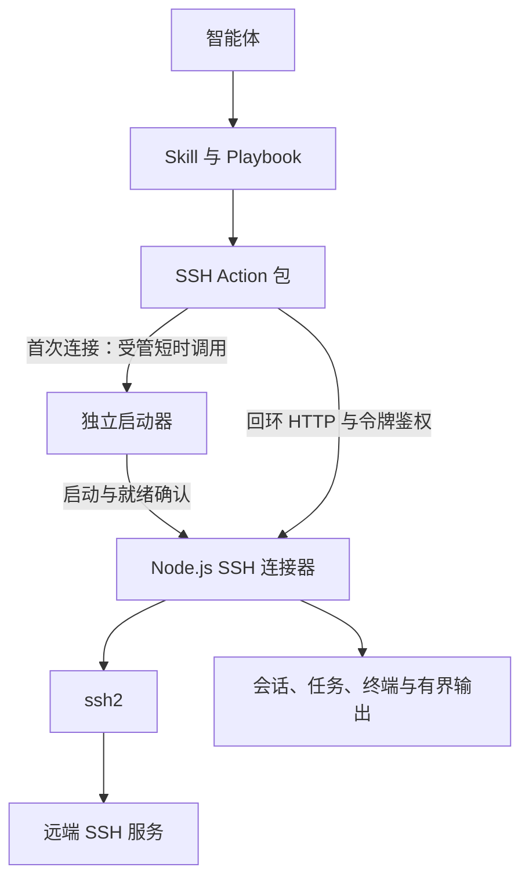
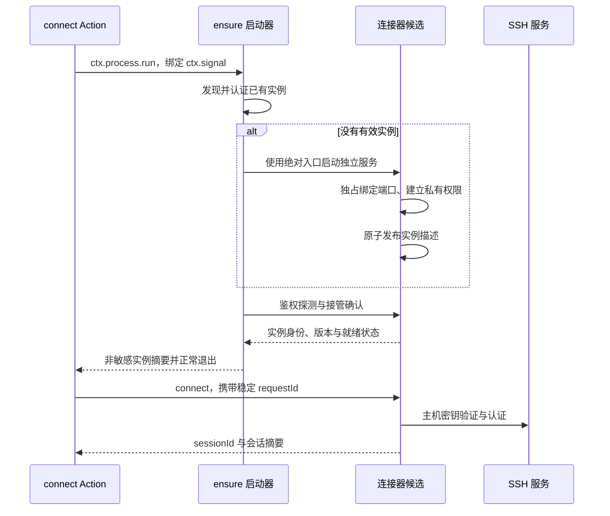

## 背景

SSH 工具通常需要在连续操作中复用已经建立的网络连接和认证上下文。若每次 Action 都创建并关闭 SSH 客户端，重复调用就会重复握手和认证，也无法持续操作同一个交互终端。

本次设计采用独立运行的 Node.js 连接器，由 `ssh2` 提供 SSH 协议能力，由 Action 提供操作契约，由 Skill 和 Playbook 描述使用与收尾规程。连接器持有长期资源，不依赖单次 Action 的存活时间。这与浏览器工具中“短命令操作常驻浏览器”的职责分工一致。

### 现状与约束

- 本地 `ad run` 通过 `withService` 创建本地服务，并在调用结束后执行 `service.close()`。跨 CLI 调用不能依赖同一内存中的 SSH 客户端。见 [`packages/cli/src/utils/target.ts`](../../packages/cli/src/utils/target.ts) 和 [`packages/cli/src/commands/run.ts`](../../packages/cli/src/commands/run.ts)。
- `ad serve` 等常驻宿主可以持续执行 Action，但连接器不能要求消费者必须采用这种部署方式。见 [`packages/cli/src/commands/serve.ts`](../../packages/cli/src/commands/serve.ts)。
- `ActionContext` 提供配置、状态、受管进程、日志和取消信号，没有独立服务所有权交接接口。`ctx.state` 存储可序列化数据，不能存储活着的 SSH 连接。见 [`packages/sdk/src/types.ts`](../../packages/sdk/src/types.ts)。
- 当前 `ContextProcessAPI.dispose()` 仅释放取消监听器，不能据此推断 Action 返回时一定终止全部进程；同样也不能据此推断受管进程能够跨新的本地宿主恢复控制。见 [`packages/core/src/process/context-process.ts`](../../packages/core/src/process/context-process.ts)。
- `ctx.process.run` 支持短时外部命令、超时和取消；驱动采用 POSIX 进程组终止，Windows 使用 `taskkill /T` 等机制清理。内部的 `detached` 配置不是对业务 Action 的独立服务契约。见 [`packages/core/src/process/run-executor.ts`](../../packages/core/src/process/run-executor.ts) 和 [`packages/core/src/process/process-driver.ts`](../../packages/core/src/process/process-driver.ts)。
- Action 内不得直接使用 `node:child_process`。调用连接器启动程序必须通过 `ctx.process`，不能通过访问核心内部句柄或裸进程调用绕过治理。
- Action 包的辅助入口和共享模块必须在 `actiondock.json.files` 中显式声明。构建器不会因为运行时拼接了一个文件路径就自动包含该文件。见 [构建与导出规范](../developer/build-and-export.md)。

`ssh2` 已提供连接、认证、心跳、独立命令通道、交互 shell 和窗口调整能力，不需要自行实现 SSH 协议。但它不是后台服务管理器，也不提供远端任务执行结果的跨进程持久化。其 `hostVerifier` 未配置时默认接受服务器密钥，必须覆盖这一默认行为。详见 [ssh2 官方文档](https://github.com/mscdex/ssh2)。

### 目标与范围

改动后的消费者可以通过多次独立的 `ad run` 操作同一个 SSH 会话；Action 结束后连接仍然存在；长任务可以提交后查询；交互终端可以保留工作目录和 shell 状态；使用完能够显式关闭，并由空闲策略兜底回收。

本次设计不增加 ActionDock 核心连接池，不修改公共 SDK，不提供跨用户的共享 SSH 平台，不承诺连接器崩溃后恢复原终端，也不承诺任意远端命令可以安全重试。SFTP、端口转发、跳板链和远端任务持久化不纳入本次交付。

跨平台指连接器及其 Action 客户端在 Linux、macOS、Windows 上使用一致的契约，不代表远端 shell 命令具有跨平台语义。远端操作系统和 SSH 服务能力仍由目标环境决定。

建议分支：`feature/ssh-connector`。这是建议名称，不表示分支已经创建。

## 整体设计

### 职责与边界



| 组件 | 职责 | 不承担的职责 |
| --- | --- | --- |
| ActionDock | 发现 Action、验证契约、配置注入、记录调用、传递取消信号 | SSH 协议、SSH 连接池、连接器任务调度 |
| SSH Action 包 | 参数转换、服务发现、受管启动、本地通信、错误转换 | 持有跨调用的连接和终端对象 |
| 独立启动器 | 启动服务、确认身份和就绪、报告启动失败 | 远端命令执行、长期承载 SSH 状态 |
| SSH 连接器 | 认证连接、资源生命周期、通道调度、任务状态和输出回收 | Agent 意图推理、ActionDock 运行记录 |
| Skill 与 Playbook | 选择目标、复用资源标识、追踪任务、明确收尾 | 用文字约定替代实际资源清理 |

连接器和 Action 随同一个 SSH Action 包分发，作为包内配套程序运行。连接器没有独立的框架发布节奏，也不成为 ActionDock 核心子包。协议定义和 Schema 在包内维护唯一事实源，Action 包装层与连接器共同消费。

### 资源模型

| 术语 | 含义 | 标识与生命周期 |
| --- | --- | --- |
| 连接器实例 | 在一个受信任运行空间内提供服务的后台进程 | `connectorId`；每次启动重新生成 |
| 目标 | 管理员配置的主机、认证来源和主机密钥约束 | `target`；不是存活资源 |
| SSH 会话 | 一次显式建立的访问上下文，拥有一条 SSH 网络连接及其通道 | `sessionId`；断开后不可复活 |
| 命令任务 | 在独立执行通道上提交的一条远端命令及其输出记录 | `taskId`；与 Action 调用寿命无关 |
| 交互终端 | 会话内持续存在的 shell 通道 | `terminalId`；保留 shell 状态 |
| 操作收据 | 一次创建或输入操作的受理与派发结果 | `requestId`；不是远端命令完成证明 |
| Action 运行 | ActionDock 对单次 Action 调用的记录 | `runId`；不是 `taskId` |

所有存活资源属于一个连接器实例。资源标识包含实例代次，旧实例的标识不能指向新实例的资源。标识是定位信息，不是鉴权凭据。

首版不做跨会话的隐式连接池。一个 SSH 会话持有一条连接，多个独立命令通道复用这条连接。只有调用方明确传入同一个 `sessionId`，或明确复用同一个 `sessionName`，才共享访问上下文。

### 两种执行语义

独立命令使用 `ssh2.exec()`。命令共享 SSH 连接，但各自具有独立的通道、标准输出和标准错误；前一次命令的 `cd`、环境变量和 shell 局部状态不会自动传给下一次命令。

交互终端使用 `ssh2.shell()`。同一个 `terminalId` 持续使用同一个 shell，因此工作目录和环境状态可以保留。终端只提供输入、输出和控制，不声称知道每条输入命令何时完成，也不通过猜测提示符或静默时长伪造退出码。

需要可靠的任务状态时使用独立命令；需要交互状态时使用终端。终端里的后台程序不自动成为可追踪的命令任务。

## 详细设计

### 配置、运行空间与服务发现

连接器默认以执行 Action 的操作系统用户运行，而不是以发起请求的 Agent 身份运行。通过 `ad serve` 或 MCP 调用时，连接器位于服务端执行机器，`127.0.0.1` 指该机器，不是 Agent 客户端机器。

以下配置是 SSH 包拟新增的契约，通过 `ctx.config` 读取后传给启动器；不是 `ad` 的现有内置选项。入口本身不接受从 Action 入参透传的文件路径或启动参数。

| 配置项 | 类型与语义 |
| --- | --- |
| `SSH_TARGETS_FILE` | 必填字符串，受保护目标配置的绝对路径 |
| `SSH_CONNECTOR_NAMESPACE` | 字符串，默认 `default`；由部署配置划分运行空间，不能作为租户凭据 |
| `SSH_CONNECTOR_MODE` | `auto` 或 `external`，默认 `auto`；决定是否允许首次调用启动服务 |
| `SSH_CONNECTOR_PORT` | 可选整数，范围 1024 至 65535；未指定时按运行空间确定 |
| `SSH_CONNECTOR_POLICY_FILE` | 可选字符串，受保护的策略文件绝对路径；未指定时使用本文初始策略 |

策略文件使用包内共享 Schema，设置握手、心跳、任务期限、空闲回收、输出、输入、日志和收据额度。策略来源、端口、目标文件路径及当前策略内容摘要参与启动参数摘要；需要改变策略时先完成收尾并重启服务，不能按请求临时放宽额度。命名空间有长度和字符集限制，文件路径不接受相对路径。

运行空间由受信任配置的 `SSH_CONNECTOR_NAMESPACE` 和包实例位置共同确定；包实例位置使用包根目录的规范绝对路径，不能使用调用时的当前工作目录。包版本和协议主版本参与实例位置计算，避免不同交付版本误用旧进程。临时调用配置若与正在运行的启动参数不一致，明确报错，不暗中复用。

默认运行目录是当前用户私有目录下的 `.actiondock/ssh-connectors/<运行空间摘要>/`，与 ActionDock 的 SQLite 数据目录分开，避免争用本地 `ad run` 的数据目录锁。目录中仅包含：

- `instance.json`：连接器代次、协议主版本、包版本、运行空间摘要、端口、PID、启动参数摘要和访问令牌。
- 有界的诊断日志及轮转文件。

访问令牌与实例描述放在同一个私有文件中原子发布，避免分开更新造成代次和令牌错配。令牌由安全随机源产生，每次实例启动更新，不出现在 Action 输出、命令行参数或运行日志中。PID 只用于诊断，不用于证明实例身份或直接终止进程。

客户端必须校验私有目录、文件权限、版本、运行空间与启动参数摘要，再向固定的回环地址发起认证握手。返回的 `connectorId` 必须与文件一致，且服务必须证明持有对应私有令牌。不能仅凭描述文件存在、PID 存活、端口可连接或回显实例标识就判定服务可用。

普通资源操作只发现已有实例，不自动启动。只有 `connect` 和显式的 `connector-start` 可以启动服务，避免查询旧任务时意外创建一个没有旧状态的新进程。

### 本地通信与跨平台约束

首版统一使用 `node:http`，只监听 `127.0.0.1`，不提供外部监听配置。客户端直接使用回环 HTTP，不依赖系统代理、不跟随重定向、不接受描述文件中的任意 URL。这样不需要维护 Unix 套接字与 Windows 命名管道的两套协议。

服务使用唯一的 `POST /v1/call` 入口，通过 `operation` 路由。除认证握手外，所有请求，包括状态查询和接管，都必须携带访问令牌。拒绝浏览器 `Origin` 请求，不提供 CORS，不接受非预期 `Host`，不把 URL 中的参数作为操作输入。令牌在长度校验后进行常数时间比较。

客户端不能直接把令牌发送给尚未确认身份的监听者。首次握手生成安全随机挑战，以私有令牌为密钥，使用 HMAC-SHA-256 对固定协议标签、预期实例标识和挑战计算客户端证明；服务校验后用不同的服务端标签返回证明，握手不传输原始令牌。客户端验证证明后，才在同一 TCP 连接上发送令牌和业务请求。传输层禁止自动换连接重发；连接断开后必须重新握手，已派发请求通过收据恢复。这样端口被其他用户占用时，对方不能通过收到一个 Bearer 令牌冒充原实例。握手字段采用固定、无歧义编码并限制长度，证明不能当成业务请求授权。

端口由运行空间摘要确定，默认映射规则为 `20000 + uint32BE(SHA256(运行空间标识)的前四字节) % 30000`；允许管理员通过 `SSH_CONNECTOR_PORT` 固定覆盖。端口映射不是容量承诺，可能碰撞。发生碰撞时返回 `SSH_CONNECTOR_ADDRESS_IN_USE`，由管理员调整配置，不能自动扫描端口、连接陌生服务或终止占用进程。

进程启动时以独占监听作为实例竞争的仲裁点，不采用“先检查端口空闲再启动”的判断。并发候选中只有成功绑定端口的实例可以发布描述文件；失败候选退出并等待发现获胜实例。禁止配置允许多个进程复用同一监听端口的选项。

POSIX 下运行目录权限为 `0700`，描述文件和日志为 `0600`，并检查路径是否指向符号链接或非预期所有者。Windows 下使用当前用户私有目录，由平台适配器设置并校验 ACL；只允许当前用户及必要的系统管理主体访问。`chmod` 不能替代 Windows ACL 验证。无法建立私有权限时拒绝启动，不降级为共享目录。

回环 HTTP 不提供针对本机管理员的保密性，私有令牌也不能隔离同一操作系统用户下互不信任的程序。本次安全边界是操作系统用户和受信任部署空间，不把任意输入的 `namespace`、Agent 名称或资源 UUID 当作租户身份。互不信任的调用方必须采用不同操作系统用户或独立执行容器。

### 启动、就绪与所有权交接

自动模式下，Action 通过 `ctx.process.run` 调用包内独立入口的 `ensure` 子命令。执行文件使用当前 `process.execPath`，入口路径通过包内 `import.meta.url` 解析，不使用 PATH 搜索到的同名程序，也不通过 shell 拼接命令。

`ensure` 的边界是一个短时、受管的外部程序。只有这个独立程序可以使用 Node.js 进程 API 启动其配套服务；Action 模块不得导入或执行启动代码。连接器不是一个返回后被遗留的 `ctx.process.start` 资源，其后续所有权由自己的服务协议、停止入口和回收规则明确承担。



启动器不继承 Action 的标准输入输出管道给连接器。服务标准输入关闭，诊断输出连接到受限日志文件；POSIX 使用独立会话，Windows 使用独立进程启动配置，并释放父进程对服务的等待引用。传给服务的环境变量采用明确允许列表，不复制整个 Action 环境，不通过启动参数携带密码或私钥。

服务先处于 `starting`。完成端口绑定、权限和描述发布后，必须收到一个已认证客户端的接管确认，才进入 `ready`。未经接管的候选超过启动接管期限自动退出；没有发布成功的候选立即清理自身资源。启动器输出成功前必须确认代次、配置和就绪状态，不能只返回派生得到的 PID。

启动取消存在竞争：若接管前启动器被清理，候选可以一并退出；若某个客户端已经成功接管，共享实例不再因另一个启动请求取消而被关闭。启动器的失败清理只能作用于自己启动且尚未被接管的候选，不能终止已被其他请求使用的实例。

当前 ActionDock 的 Windows 驱动使用进程树清理；独立服务能否在正常启动器退出后持续存活，必须在三个目标平台上进行真实验证，不能把 Node.js 的 `detached` 参数当成已验证结论。操作系统作业、容器或上层工具可能强制回收整个执行环境，此时包内代码不能保证脱离宿主生命周期。

因此同时提供 `external` 模式：由用户或服务管理器预先运行连接器的 `serve` 入口，Action 只发现和使用。受限环境必须采用此模式；自动模式不满足独立存活条件时返回 `SSH_CONNECTOR_DETACH_UNSUPPORTED`，不能反复启动或绕过宿主安全策略。无需引入 ActionDock 核心接口才能使用预启动模式。

### 目标配置与认证来源

Action 入参仅指定已配置的 `target`，不接受任意主机、密码、私钥文本或私钥路径。连接器从 `SSH_TARGETS_FILE` 指向的受保护文件读取目标定义，文件与密钥不进入包或 Skill 产物。

下面是目标文件的设计示例，路径和指纹必须替换为实际受信任值：

```json
{
  "targets": {
    "production": {
      "host": "203.0.113.10",
      "port": 22,
      "username": "deploy",
      "hostKeyFingerprints": ["SHA256:<实际主机公钥指纹>"],
      "auth": {
        "type": "privateKey",
        "privateKeyFile": "/home/user/.ssh/deploy_ed25519",
        "passphraseFile": "/home/user/.config/ssh-connector/deploy-passphrase"
      }
    }
  }
}
```

首版支持私钥认证和密码文件认证。加密私钥的解密口令由独立受保护文件提供；不支持交互式认证提示。SSH Agent、Pageant 和键盘交互认证不作为首版跨平台承诺。

所有文件路径都是执行机器上的规范绝对路径。配置文件、私钥和口令文件均进行权限及大小校验；错误信息不得附带文件内容。口令和私钥只为连接建立而读取，不保留在操作收据、会话摘要或任务结果中。释放引用只能减少暴露时间，不能承诺 JavaScript 内存已经安全擦除。

主机密钥使用 `hostVerifier` 显式验证。对服务器原始公钥计算 SHA-256，再按 OpenSSH 指纹格式进行精确比对；未知或不匹配的密钥拒绝连接，不进行静默首次信任，也不修改目标文件。主机密钥轮换通过管理员事先配置允许指纹完成。

新会话读取并固定目标配置快照。具名会话复用必须匹配目标和配置修订；配置已变更时返回冲突，要求关闭后重新连接。配置更新不暗中修改已有连接的身份。需要立即撤销访问时，管理员必须显式关闭相关会话或整个连接器。

### 会话建立与复用

`connect` 在鉴权、输入验证和额度预占之后建立 `ssh2.Client`，设置握手超时和心跳，并绑定错误、关闭等事件。主机密钥验证及认证完成后才能发布 `sessionId`。失败时释放连接和额度，返回明确错误。

`sessionName` 是可选的显式复用名称。在同一运行空间中，名称与目标配置匹配时复用已有就绪会话；并发首次建立同名会话共享同一个在途建立过程。名称相同但目标或配置不同则拒绝，不按主机名猜测复用关系。

没有 `sessionName` 的新请求创建独立会话。不同会话不共享物理连接，即使连接同一台服务器，也不会隐式共享终端或任务。此边界优先保证资源所有权清晰，接受重复建立少量连接的代价。

只有 `connecting` 或 `ready` 会话参与具名复用。关闭或失联时移除名称绑定，新请求才可以用同名建立新会话；旧请求的收据仍指向原会话，重试旧请求不会复活资源。

会话状态为 `connecting`、`ready`、`closing`、`closed`、`failed`、`lost`。断线转入 `lost`，所有关联通道标记失联，不能自动重建原会话。重新连接产生新的 `sessionId`，不重放旧命令，也不恢复旧终端。

### 命令任务与执行结果

`exec` 验证会话后，先预占任务、输出和幂等额度，创建 `taskId` 及操作收据，再向 SSH 发送执行请求。任务提交成功不代表远端命令成功。

命令是明确交给远端 SSH 服务执行的字符串，不宣称具有本地 `argv` 的安全语义。首版不自动拼接工作目录、环境变量或 shell 包装脚本。调用方必须针对远端 shell 提供命令，独立命令之间不保留环境。

任务独立于 HTTP 请求和 Action 调用存活。`exec` 可以在有限的 `waitMs` 内等待并返回已有输出；等待结束时尚未完成，仍返回 `taskId` 和当前状态，后续通过 `task-read` 与 `task-inspect` 查询。提交结果始终提供初始或已读取后的输出游标，供下一次读取使用；本地等待最长 5 秒，默认不等待。没有收到提交响应时，通过原 `requestId` 查询操作收据，而不是再次提交新命令。

任务状态为 `pending`、`running`、`finished`、`failed`、`lost`。状态只向前收敛；`cancelRequested` 和 `deadlineReached` 是附加信息，不伪装成远端已经停止。任务结果同时包含：

- `dispatchState`：`not_sent`、`accepted` 或 `unknown`，表明本地对派发结果的认识。
- `exitCode` 和 `exitSignal`：只有服务器报告时才有值。
- `exitReported`：服务器是否报告退出结果。
- `remoteOutcome`：`known` 或 `unknown`，区别已知退出与无法确认。
- `outputClosed`：本地输出是否已经收敛。

`ssh2` 文档明确说明退出事件是可选的，因此通道关闭但没有退出报告时不能补一个退出码 `0`。此时可以结束本地输出追踪，但 `remoteOutcome` 保持 `unknown`。

远端命令返回非零退出码属于已知任务结果，不是连接器内部异常。Action 成功返回该结果，不让 Agent 把非零退出码误判成“请求没有执行”。调用方按照 `exitCode` 决定业务成功与否。

取消和任务期限使用同一停止流程：记录停止请求，尝试向通道发送 `TERM`，在宽限期后关闭本地通道，不关闭其他任务所共享的 SSH 连接。服务器可能忽略信号，通道关闭也不能证明远端进程或其后台子进程已经退出。没有退出确认时明确返回结果未知，必须通过新的只读操作核查远端状态。

取消一个 Action 的等待或查询只停止本地等待。Action 的 `ctx.signal` 始终绑定本地网络调用和受管启动，但不会自动扩大为远端任务取消。需要取消远端任务时必须调用 `task-cancel`；任务自身期限由连接器执行，不依赖 Action 是否仍在运行。

### 交互终端与输入收据

`terminal-open` 在已有会话上创建持续 shell 通道，返回 `terminalId`、初始输出游标、终端尺寸与本地租约期限。终端状态为 `opening`、`ready`、`quarantined`、`closing`、`closed`、`lost`。

同一终端的输入按受理顺序串行派发；每次 `terminal-write` 必须有稳定的 `requestId`，提供文本输入或 Base64 字节输入，二者互斥。收据区分 `queued`、`dispatching`、`accepted`、`failed`、`unknown`；`acceptedBytes` 只表示本地流写入获得受理，不表示远端命令完成。

写入回调失败、通道丢失或派发过程中发生无法判断的中断时，输入结果标记 `unknown`，终端进入 `quarantined`，拒绝继续写入，防止对半执行的状态进行重复输入。隔离终端仍可查询输出和关闭；不能仅通过重试原输入解除隔离。

`terminal-control` 只提供尺寸调整、输入 EOF 和中断请求，并要求稳定的 `requestId`。控制与输入采用同一终端派发序列，EOF 受理后拒绝新的输入；重复请求不会重复发送中断，避免第二次中断作用于后来运行的程序。尺寸调整使用 `setWindow`；中断优先使用 SSH 信号请求，必要的 PTY 控制字符方式必须由操作明确选择。返回控制请求的受理结果，不承诺服务器支持或前台程序已经停止。终端能力受远端服务限制，不支持的操作返回明确错误。

终端读写与控制会续期用户活动租约，远端输出和 SSH 心跳不会续期。持续运行但无人操作的交互程序可能在租约到期后被关闭，因此需要长期追踪的程序应通过 `exec` 提交，不能依赖终端输出自动保活。

不同调用方不得无协调地共同操作同一个终端。输入串行化保证字节不交错，不保证多个 Agent 的意图不会互相干扰；Skill 默认创建独立终端，共享必须显式传递标识并由上层协调。

### 有界输出、编码与游标

连接器为任务和终端维护有界事件日志。事件包含递增序号、流标识、原始字节及派生文本。任务区分 `stdout` 与 `stderr`；PTY 终端的展示以 `pty` 流为主，不承诺标准错误在终端语义下仍可独立分离。

接收侧按流维护独立的增量 UTF-8 解码器，在追加事件时生成文本视图，处理跨数据块的多字节字符。文本只解码一次，后续游标读取不是重新对任意截断字节做无状态解码。原始字节以 Base64 返回，保留二进制数据和终端控制序列；无效 UTF-8 的文本视图允许替换字符，不改变原始字节。

大型数据块拆成最多 4 KiB 原始字节的事件，日志额度同时计算原始字节、文本视图和事件开销。`maxBytes` 按原始字节计，允许范围为 4 KiB 至 64 KiB；响应另外限制为 256 KiB，计入 Base64、文本和元数据，达到任一限制即结束本页。读取不消费共享日志；在数据仍被保留且选取同一尾部边界时，同一游标返回相同事件，不会因读取产生副作用。游标绑定连接器代次、资源与事件序号，不能跨资源使用。

读响应至少包含 `chunks`、`nextCursor`、`earliestCursor`、`tailCursor`、`gap`、`outputClosed`、`eof` 和资源状态。`eof` 只有输出已关闭且游标追平时成立；一次没有新输出不代表任务完成。

日志覆盖旧事件时报告 `gap`。调用方选择 `onGap=error` 或 `onGap=skip`，默认报错，不能静默声称输出完整。返回的文本可能包含远端终端控制序列或不可信内容，消费者不得将其当作新的系统指令。

任务结束和终端关闭后继续保留结果与输出，直到结果保留期到期；到期后释放日志、解码器和资源详情，旧标识明确返回过期。终态记录回收不删除派发收据，收据保留规则见下节。连接器不落盘保存远端输出，也不在内存中无界保留整个构建日志。需要完整长期日志时应让远端程序写入受控文件，本次设计不提供自动下载功能。

### 本地协议、幂等与错误

下面是目标协议结构，不是当前 ActionDock 接口：

```json
{
  "protocolMajor": 1,
  "connectorId": "<连接器实例标识>",
  "requestId": "<调用方为本次操作生成的稳定标识>",
  "operation": "task.submit",
  "input": {
    "sessionId": "<会话标识>",
    "command": "<远端命令>",
    "taskTimeoutMs": 1800000
  },
  "trace": {
    "actionRunId": "<本次 ActionDock 调用标识>"
  }
}
```

客户端通过请求头提供访问令牌。连接器独立执行共享协议 Schema 校验，不信任请求已经经过 Action 验证；在 `starting` 状态只接受发现与接管操作，在 `ready` 状态才接受资源创建。创建会话、任务、终端及终端输入和控制必须有 `requestId`。Action 的 `runId` 仅用于追踪，不能默认替代跨调用重试所需的稳定请求标识。

幂等键为连接器代次、操作类型和 `requestId`。完成输入标准化后计算摘要，在任何远端派发前同步预占收据：

- 相同键和相同有效输入返回已有收据或资源标识，并发请求共享在途结果。
- 相同键但不同输入返回 `SSH_REQUEST_CONFLICT`。
- 收据记录为结果未知时，查询和重复请求仍返回未知，不重新派发。
- `trace` 和 `exec` 的本地等待时长不参与远端派发摘要；命令、会话、输入字节和任务期限参与。

派发收据保留到连接器实例退出，避免任务输出回收后再次提交原请求。收据只保存摘要、资源标识和非敏感状态，不保存原始输入或认证材料。达到收据额度时拒绝新的创建、写入和普通终端控制操作，不通过淘汰旧收据来释放额度。读取、取消和关闭不受这个额度阻塞；这些清理操作按固定资源标识实现天然幂等。终端中断不能作为额度耗尽时的清理保证，需要结束资源时使用 `terminal-close`。

保证只覆盖存活实例内的去重，不提供跨进程崩溃的“恰好执行一次”。客户端在同一实例中发生响应丢失，可以使用原请求查询或重试；旧实例已经消失时，执行结果未知，不能在新实例中重放有副作用的操作。

连接器成功响应包含 `connectorId`、`requestId` 和 `data`，失败响应包含明确的 `code`、脱敏的 `message` 与 `details`。HTTP 连接故障不会自动转换成远端命令未执行。

| 错误 | 含义与处理 |
| --- | --- |
| `SSH_CONNECTOR_NOT_RUNNING` | 服务不存在；只有建立新连接或显式启动可以拉起 |
| `SSH_CONNECTOR_START_TIMEOUT`、`SSH_CONNECTOR_DETACH_UNSUPPORTED` | 启动未就绪或宿主不允许独立存活；检查候选清理，必要时使用预启动模式 |
| `SSH_CONNECTOR_ADDRESS_IN_USE` | 端口被非匹配服务占用；调整受信任端口配置，不终止占用方 |
| `SSH_CONNECTOR_VERSION_MISMATCH`、`SSH_CONNECTOR_AUTH_FAILED` | 实例版本或身份不匹配；不得继续发送资源操作 |
| `SSH_RESOURCE_EPOCH_MISMATCH` | 资源属于旧实例；禁止在新实例重放 |
| `SSH_TARGET_NOT_ALLOWED`、`SSH_CONFIG_INVALID` | 目标未配置或配置不合法；拒绝连接 |
| `SSH_HOST_KEY_MISMATCH`、`SSH_AUTH_FAILED`、`SSH_CONNECT_TIMEOUT` | 主机身份、用户认证或握手失败；修正配置后建立新会话 |
| `SSH_CONNECTION_LOST` | SSH 连接失联；原资源不可复活，先核查远端副作用 |
| `SSH_REQUEST_CONFLICT`、`SSH_REQUEST_OUTCOME_UNKNOWN` | 请求身份冲突或执行结果不确定；不自动重放 |
| `SSH_RESOURCE_BUSY`、`SSH_TERMINAL_QUARANTINED` | 资源正在使用或终端输入结果不确定；拒绝破坏性操作或继续输入 |
| `SSH_RESOURCE_EXPIRED`、`SSH_OUTPUT_GAP` | 结果已回收或输出缺失；不能返回伪造的完整结果 |
| `SSH_QUOTA_EXCEEDED`、`SSH_UNSUPPORTED_OPERATION` | 达到配置额度或远端能力不支持；明确失败，不静默降级 |

Action 包使用自己的错误类型保留 `code` 和已脱敏的 `details`，由 ActionDock 现有错误归类链路传递，不新增核心 SSH 错误常量。当前普通执行错误会读取错误对象的 `code` 和 `details`；Action 取消或超时仍优先归类为 ActionDock 的对应错误，不能靠外层错误码推断远端任务是否终止。见 [`packages/core/src/execution/service.ts`](../../packages/core/src/execution/service.ts)。

### Action 契约

包标识使用 `team4u.ssh` 作为目标设计名称。下表是拟新增的 Action，不表示当前仓库已经提供这些命令。所有契约在 `actiondock.json` 中登记，输入和输出使用完整 JSON Schema，默认拒绝额外字段，并对标识、字节数、尺寸与时限设置约束。

| Action | 核心入参 | 核心结果与语义 |
| --- | --- | --- |
| `connector-start` | 无资源入参 | 启动或复用服务，返回非敏感实例摘要 |
| `connector-status` | 无资源入参 | 返回已停止或当前实例状态；不自动启动 |
| `connector-stop` | `connectorId`、`force` | 无活跃资源时停止；强制停止必须明确指定实例 |
| `connect` | `target`、可选 `sessionName`、`requestId` | 建立或显式复用会话，返回 `sessionId` |
| `session-list`、`session-inspect` | 可选过滤条件或 `sessionId` | 返回当前空间可见的非敏感会话信息 |
| `session-close` | `sessionId`、`force` | 有活跃通道时默认拒绝；明确强制后关闭关联资源 |
| `exec` | `sessionId`、`command`、`requestId`、可选时限和等待时长 | 返回 `taskId`、任务状态、游标与本次有限输出，不假定已完成 |
| `task-inspect` | `taskId` | 返回派发、退出、停止请求及输出状态 |
| `task-read` | `taskId`、`cursor`、读取上限、等待时长、断层策略 | 返回有界增量输出和下一游标 |
| `task-cancel` | `taskId` | 记录并尝试停止任务，返回确认程度，不关闭共享连接 |
| `operation` | 操作类型、原 `requestId` | 查询创建、输入或控制请求的收据 |
| `terminal-open` | `sessionId`、终端类型与尺寸、`requestId` | 返回 `terminalId`、游标和租约期限 |
| `terminal-read` | `terminalId`、游标与读取约束 | 返回原始输出和文本视图，续期活动租约 |
| `terminal-write` | `terminalId`、文本或 Base64 字节、`requestId` | 返回输入收据，不返回伪造的命令完成状态 |
| `terminal-control` | `terminalId`、控制类型及对应参数、`requestId` | 请求尺寸调整、EOF 或中断，不重复派发同一请求 |
| `terminal-close` | `terminalId` | 关闭指定终端，不关闭同会话的其他通道 |

Action 不把本地访问令牌、密码、私钥或完整目标配置返回给消费者。`ctx.state` 不参与存活资源的事实判断；如上层规程记录会话标识，只能把它作为需要再次验证的提示，不能视作连接仍存活的证明。

### 配额、期限与回收

下列数值是本次设计的初始默认策略，不是当前 ActionDock 默认值，也不是已经验证的容量结论。连接器启动时读取策略并固定，调用方只可以在上限内选择更严格的请求约束。

| 项目 | 初始默认策略 |
| --- | --- |
| 启动器等待就绪与 SSH 握手 | 分别为 10 秒，二者不是同一个等待期限 |
| 未接管候选存活 | 最长 30 秒 |
| SSH 心跳 | 间隔 30 秒，连续 3 次无应答判定失联 |
| 无存活资源和保留输出时的连接器空闲退出 | 5 分钟 |
| 无活跃任务或终端的会话空闲回收 | 10 分钟 |
| 交互终端无用户活动租约 | 10 分钟 |
| 独立任务期限 | 默认 30 分钟，管理员允许范围内可显式调整 |
| 已结束任务与终端输出保留 | 15 分钟 |
| 停止宽限期 | 5 秒 |
| 活跃会话 | 每实例最多 8 个 |
| 活跃任务和终端通道 | 每实例合计最多 32 个，每会话最多 8 个 |
| 活跃终端 | 每会话最多 2 个 |
| 单资源输出日志 | 最多 1 MiB，包含字节、文本视图与事件开销 |
| 实例输出日志 | 合计最多 32 MiB，最多保留 256 个资源日志 |
| 读取结果 | 原始字节每次最多 64 KiB，响应最多 256 KiB，长轮询最长 5 秒 |
| 单次终端输入与输入队列 | 输入最多 64 KiB；每终端待写队列最多 1 MiB，实例合计最多 4 MiB |
| 本地协议请求正文 | 最多 128 KiB |
| 派发幂等收据 | 每实例最多 10000 条 |
| 诊断日志 | 单文件最多 2 MiB，最多保留 3 个文件 |

额度必须在创建资源或入队前预占，所有失败分支释放可回收额度；收据保留额度按前述去重规则处理。输出不足时覆盖本资源旧事件并报告断层，不能挤占其他资源或无限扩容。对于不能安全释放的全局额度直接拒绝请求。

SSH 心跳只负责发现失联，不计为用户活动。运行中的任务阻止所属会话按空闲回收；终端独立遵循活动租约。已结束任务保留的输出阻止连接器提前空闲退出，但不会阻止空闲 SSH 连接被关闭。

`session-close` 默认在有活跃任务或终端时返回忙碌。`connector-stop` 默认在有活跃资源或尚处保留期的输出时拒绝。强制操作明确关闭本地资源并丢弃相应保留结果，同时标示未确认的远端执行状态，不声称撤销已经发生的远端副作用。

服务停止先进入 `draining`，拒绝新的创建和输入，完成停止请求的响应后再关闭监听与资源。只清理描述文件中的同一 `connectorId`，不能删除后来启动实例的文件。停止失败记录明确诊断；管理端不能因为一个关闭失败而静默跳过其他资源清理。

### 崩溃、重启与故障恢复

连接器的会话、终端、任务状态和输出只保存在内存中。重启后全部失效，不从描述文件恢复活连接，不把旧任务标记为成功或自动重新执行。

实例描述可能因崩溃残留。只有候选已成功独占绑定预期端口、确认没有匹配的存活服务后，才可以覆盖残留描述。认证失败、版本不匹配或未知监听者均不是可以清理对方的理由。遇到证据不足时保守报错，由管理员处理。

SSH 连接断开或连接器消失时，远端命令可能已经完成，也可能继续运行。恢复过程先记录原 `connectorId`、`requestId` 和可获得的任务信息，再建立新连接，用只读查询核实远端状态；业务操作是否重新执行由规程决定，不由底层自动重试。

本次不提供远端进程树终止、终端断线重接或任务结果持久化保证。若未来需要连接器重启后继续控制原任务，必须增加远端任务宿主或明确的持久化执行协议，而不是把本地状态文件当成任务恢复能力。

### 安全与可观测性

连接器拥有远端用户的权限，主机身份验证和目标白名单必须在任何命令派发前完成。默认不启用 SSH Agent 转发、X11 转发、TCP 转发或任意外部监听。部署账号应采用与目标任务匹配的最小权限。

Action 输入输出及 ActionDock 运行记录可能包含命令和远端输出。配置项标记为敏感，不会自动识别并隐藏远端返回的秘密。因此认证材料不进入 Action 入参，命令、终端输入和结果也不得默认打印到诊断日志；消费者仍需保护 ActionDock 数据目录并避免把秘密直接写入命令。

连接器日志只记录实例、资源、请求及 Action 运行标识、操作类型、状态变化、字节计数、耗时和脱敏错误。命令正文、终端输入、远端输出、访问令牌和认证文件内容不进入默认日志。远端输出始终作为不可信数据处理。

`connector-status` 提供版本、实例代次、存活时长、资源数量、额度使用、最近清理原因和诊断错误摘要，不能输出完整目标配置。连接器日志有大小和文件数量上限，轮转失败不能无限增长；权限或日志设施失效时拒绝新的创建操作，保留查询和收尾能力。

## 交付与使用影响

SSH Action 包包含 Action 入口、共享协议与客户端模块、独立连接器入口、Playbook 和 Skill 说明。`actiondock.json.files` 显式包含连接器入口与公共模块，不能只依赖 Action 的静态导入关系。

独立入口采用 `.mjs`，内部若使用 TypeScript，则使用 Node.js 24.12.0 以上可直接擦除的语法和显式可解析后缀；不依赖 ActionDock 在 Action 加载阶段安装的模块解析钩子。入口从自身位置解析依赖和包配置，不能依赖全局 npm 命令或源码工作区。

`ssh2` 作为锁定的生产依赖分发。它包含可选原生优化和安装脚本，不能据此承诺所有导出模式天然跨平台。产物默认不依赖原生优化，在禁用安装脚本和缺少可选原生模块时验证纯 JavaScript 路径；若某个依赖只能通过本机安装生成文件，则不能复制本机产物到另一平台并声称可用。遵循现有依赖物化的安装脚本门禁，不为该包自动放开脚本。

源码型 Skill、Node 目录型 Skill、npm 包和独立构建目录都必须包含独立入口及依赖。Node 目录型消费还需确保 CLI 运行入口之外，连接器自己的入口也能在干净目录中直接启动。运行目录、描述令牌、目标配置、私钥、口令和运行日志不得进入产物。

Skill 的主流程是选择受信任目标、建立会话、明确选择独立命令或终端、保留资源及请求标识、追踪输出、解释未知状态，最后关闭自己的终端和会话。只有确认没有其他资源使用者时才停止整个连接器；不能把共享服务的 `connector-stop` 当作每个规程的默认收尾。

该包不要求使用 `ad run --async`。连接器任务是包自身的后台资源；本地同步 Action 也可以提交并查询。ActionDock 的 `ad runs` 只追踪 Action 调用，不能代替连接器的任务查询。

## 发布

### 上线前检查

- 在目标部署空间准备受保护的目标文件、认证文件与主机公钥指纹，确认执行机器和账号。生产指纹通过受信任渠道取得，不能从未经验证的首次连接自动接受。
- 校验运行空间、端口和目录权限，确定自动启动或预启动模式；受限制的 Windows 作业、容器及上层宿主采用经过验证的部署方式。
- 完成三个平台的启动、正常父进程退出、取消、停机和残留回收验证；未通过独立存活验证的平台不得宣称支持自动模式。
- 在禁用安装脚本的干净环境验证生产依赖、独立入口、源码和 Node 导出形态，确认未混入本机原生产物与认证文件。

按照 [版本发布与分发规范](../release.md) 先发布独立 SSH 包的预发布版本，不改变 ActionDock 核心包的默认行为，也不让测试版本覆盖正式分发标签。

先验证连接、复用、独立命令、取消请求和关闭，再开放交互终端入口；终端写入隔离、游标断层和活动租约必须通过对应案例后才能随 Skill 宣称可用。使用是否出现重复派发、跨空间访问、结果未知被误报成功、资源失控或权限失效作为暂停条件，不预设未经测量的性能比例。

观测入口是 `connector-status`、操作收据、任务与终端状态，以及受保护的连接器诊断日志。发布后重点观察实例重复启动、资源回收原因、失联与未知结果、额度拒绝和启动方式不兼容。

### 版本替换与恢复

包版本参与运行空间定位，新版本不自动连接旧版本实例，也不强制接管旧会话。升级前完成或明确停止旧实例的任务，关闭旧终端和会话，再停止旧连接器，之后启用新包。若旧版消费者仍需要完成收尾，必须保留其原交付目录与入口。

恢复旧包前先停止新实例，确认没有需要继续追踪的任务和保留输出，再使用旧包建立新的会话。版本回退只能恢复调用实现，不能恢复已经丢失的 shell 状态、内存输出、任务收据，也不能撤销远端命令的副作用。对不确定任务先核查远端状态，不自动重新部署或重复执行。

本次没有 ActionDock 数据库结构迁移。连接器描述包含协议和版本，自身不承担历史状态迁移；描述残留由发现和端口仲裁流程处理。故障处置不得只凭 PID 杀进程，优先使用匹配实例的鉴权停止入口；服务已经不可达时由管理员依据操作系统工具核实身份后处理。

## 测试

以下案例是实现后的验证要求，不表示当前已经执行或通过。

### 确定性单元测试

Action 包装层通过 `createTestRuntime` 验证契约、配置、错误传递和取消；涉及启动器的调用使用 `FakeProcessDriver`，不在单元测试中启动真实进程。连接器的 SSH 驱动、时钟、文件系统、启动器和本地通信通过可替换端口测试，真实 `ssh2` 只出现在独立集成环境。

| 前置条件与输入 | 目标路径 | 可观察的预期结果 |
| --- | --- | --- |
| 同名会话的两个首次请求并发到达 | 会话建立去重 | 只建立一条连接，配置一致时返回同一会话 |
| 名称相同但目标或配置修订不同 | 会话复用校验 | 明确冲突，不复用错误身份 |
| 无会话名的两个不同创建请求 | 独立会话 | 创建独立连接和标识，没有隐式池化 |
| 相同请求身份及输入并发提交 | 幂等预占 | 只派发一次，共享任务或输入收据 |
| 原请求身份改用不同命令或输入 | 请求摘要校验 | 返回冲突，不向远端写入 |
| 执行受理后响应丢失 | 收据查询与同请求重试 | 返回原标识，不创建第二个任务 |
| 写入部分派发后错误 | 输入不确定性隔离 | 收据未知，终端隔离，后续写入拒绝 |
| 收据额度耗尽 | 有界去重 | 新创建和写入拒绝，读取、取消和关闭仍可用 |
| 新实例收到旧资源或游标 | 代次验证 | 明确拒绝，不自动重建资源 |
| 服务拒绝主机公钥或认证失败 | 连接清理 | 不派发命令，连接与额度释放，错误不泄密 |
| 命令以非零退出码结束 | 已知业务结果 | 返回真实退出码，不伪装成请求未执行 |
| 通道关闭且无退出事件 | 未知退出结果 | 输出收敛但结果未知，退出码不是补出的零 |
| 查询或等待被取消 | 取消边界 | 本地等待结束，远端任务不被隐式取消 |
| 任务期限到达且服务器忽略信号 | 停止确认 | 请求停止并收敛本地资源，远端状态明确未知 |
| 多个任务共享会话，其中一个被取消 | 通道隔离 | 其他任务和 SSH 连接不受影响 |
| 两个终端输入请求并发 | 输入队列 | 字节按受理顺序写入，不交错 |
| 中断响应丢失后重复原控制请求，或 EOF 后继续写入 | 控制幂等与输入边界 | 不重复发送中断，EOF 后输入拒绝 |
| UTF-8 字符跨块，标准输出与错误交错 | 增量解码 | 文本正确，原始字节保留，流互不污染 |
| 旧游标被环形日志覆盖 | 输出断层 | 默认明确报错，跳过模式返回 gap 与可用游标 |
| 没有新输出但任务仍运行 | 长轮询与完成判断 | 返回未完成状态，eof 不成立 |
| 任务输出过保留期后重试原提交 | 输出回收与收据保留 | 返回原任务身份及结果过期，不重新执行 |
| 心跳或远端输出持续发生但无用户活动 | 空闲策略 | 不错误续期终端；活跃独立任务不被空闲回收 |
| 有活跃资源时普通关闭或停止 | 生命周期保护 | 返回忙碌；只有显式强制才释放相关资源 |
| 未接管候选、关闭失败和新实例文件竞争 | 启动与回收 | 候选到期退出；错误可见；不删除其他代次文件 |
| 日志、异常对象与操作收据含认证输入 | 脱敏边界 | 不输出或存储令牌、密码、私钥和原始输入 |

### 本地协议与安全测试

- 没有令牌、错误令牌、错误代次、错误运行空间、非预期 `Host` 或带浏览器 `Origin` 的请求均被拒绝；拒绝响应不泄露有效令牌或目标配置。
- 描述文件被替换为外部 URL、符号链接、非私有权限文件或不匹配版本时，客户端拒绝使用；不发送认证材料到任意地址，也不跟随重定向。
- 流式超大正文、非法 Base64、越界尺寸、非法游标和超过读取上限的请求在派发前拒绝，实例内存不随请求无界增长。
- 不同部署空间不能使用对方资源；同一操作系统用户下的互不信任隔离不计为已提供能力，部署验证检查其独立用户或容器边界。
- 固定端口冲突时不扫描替代服务、不覆盖未知实例描述、不按 PID 终止占用进程。模拟未知监听者回显实例标识或伪造握手证明，客户端仍拒绝，且不会发送访问令牌或命令正文；握手后连接被关闭时不自动换连接重发。

### 跨平台与真实 SSH 集成测试

| 前置条件与输入 | 目标路径 | 可观察的预期结果 |
| --- | --- | --- |
| 在 Linux、macOS、Windows 各执行两次独立 `ad run` | 自动启动与跨调用复用 | 首次连接后父调用退出；第二次仍操作同一实例和连接，服务端可观测到没有再次认证 |
| 多个本地调用同时首次连接 | 实例竞争 | 只有一个匹配实例发布，失败候选退出，所有成功调用使用获胜实例 |
| 首次启动被超时或取消，与另一请求接管并发 | 所有权交接 | 未接管候选回收，已经共享的实例不被错误关闭 |
| 上层宿主强制回收整个作业或容器 | 受限部署 | 自动模式不宣称成功保留；预启动服务在独立部署边界内可用 |
| 打开终端执行 `cd` 后，由另一次 Action 查询目录 | 持续 shell | 终端保留目录；独立 exec 不错误继承该目录 |
| 远端为不同操作系统或拒绝 PTY、信号请求 | 远端能力边界 | 不补造能力；控制请求与终止确认状态准确 |
| SSH 断网、服务器重启或连接器被强制结束 | 失联与恢复 | 旧资源失效，不自动重放命令，新连接获得新标识 |
| 请求被受理后客户端连接断开 | 后台任务 | 任务继续受期限和额度约束，后续能够查询原请求 |
| 主机公钥变更、私钥口令错误、认证文件权限错误 | 身份与凭据边界 | 连接拒绝，诊断不泄密；已有会话的配置快照规则保持一致 |
| 强制停止时远端命令派生后台子进程 | 远端停止限制 | 不声称远端进程树已被终止，提示结果未知并允许只读核查 |
| 运行目录有空格、非 ASCII 字符，调用时切换目录 | 路径解析 | 绝对入口与参数数组正确，运行空间不随 cwd 改变 |
| 预发布源码 Skill、Node Skill、npm 包及独立构建目录 | 分发完整性 | 干净机器能够发现、启动和关闭连接器；没有认证文件、运行描述或本机原生依赖泄漏 |

真实 SSH 集成测试使用专用测试账号和隔离服务器，不访问生产目标。副作用测试使用可观测的测试标记确认派发次数，不能仅凭客户端返回相同 `taskId` 就认定没有重复执行。实现发布时执行包级契约、类型、单元与集成验证，并遵循仓库的正式发布门禁。
