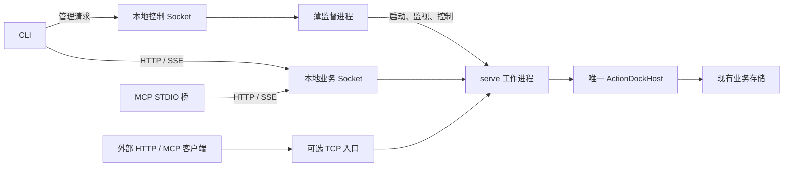

## 背景

本地调用需要共享一个长期存活的执行服务，使异步任务不依赖提交命令的生命周期，并为后续定时任务和共享连接提供运行基础。实现应复用现有 `ad serve`，而不是再建立一套动作执行平台。

现有实现具备主要业务能力，但进程和传输方式需要调整：

- [CLI 服务装配](../../packages/cli/src/utils/target.ts) 的本地分支创建 Host，调用结束后关闭；[执行命令](../../packages/cli/src/commands/run.ts) 拒绝本地异步提交。
- [serve 命令](../../packages/cli/src/commands/serve.ts) 已装配 Host、HTTP 路由和 MCP 端点，但在前台运行。
- [MCP STDIO](../../packages/mcp/src/stdio.ts) 默认创建自己的执行子进程，也支持注入已有服务。
- [HTTP 服务端](../../packages/core/src/server/http-server.ts) 目前只装配 TCP 地址；[普通客户端请求](../../packages/core/src/client/transport.ts) 与 [SSE 请求](../../packages/core/src/service/sse-stream.ts) 都需要增加本地 Socket 传输支持。
- [统一服务接口](../../packages/core/src/service/types.ts) 已包含发现、执行、运行记录、事件和配置状态能力，可以直接复用。

本次设计采用薄监督进程托管一个 `serve` 工作进程。本地消费命令默认自动发现、启动并连接该服务，不要求用户指定 daemon 地址、TCP 端口或重复传入 `--daemon`。

本期交付后台启动、即时故障恢复、本地无端口通信、统一调用和可选 TCP 入口。不实现 Action 平台、自动安装、定时调度、通用共享资源接口、进程池、零中断热替换或完整自升级系统；这些能力不进入监督进程。

以下命令和机制均为尚待实现的目标设计。建议分支为 `feature/local-resident-host`，不是已有分支声明。

## 整体设计

### 两个后台进程，一个执行宿主

每个 ActionDock 用户目录最多运行一个监督进程和一个受其管理的 `serve` 工作进程。用户目录遵循现有 `customHome` 规则，不固定为某个操作系统路径。



监督进程只处理生命周期，不装载 Action、不创建 Host、不打开业务数据库，也不转发普通业务请求。CLI 和 MCP 在完成发现后直接连接工作进程。

工作进程复用现有 `serve` 的业务装配，拥有唯一 Host、执行服务、业务存储和事件流。本地 Socket 与可选 TCP 监听共享该 Host，不存在独立网关进程，也不为每次调用派生一个 `ad run` 子进程。

### 监督职责

监督进程只承担：

- 启动工作进程并等待就绪。
- 监视退出，区分意外崩溃、主动停止和受控重启。
- 对意外退出执行有上限的退避重启，连续失败后进入可查询的失败状态，禁止无限重启。
- 转交有限的控制请求，如状态、停止、重启和启停 TCP 入口。
- 在内存中保留当前启动参数，供工作进程恢复使用。

Action 是否繁忙、任务如何取消、数据库如何关闭，由工作进程判断和处理。监督进程不建立另一份任务表、任务标识或运行状态机。

## 详细设计

### 命令行为

本地消费命令在目标解析为本地后，默认连接后台服务。远端 Profile、服务地址及现有目标解析优先级保持有效；远端失败不回退本地。项目初始化、校验、构建和测试仍使用原有工程链路，不为这些命令启动服务。

目标调用形式如下：

```bash
# 自动发现或后台启动，等待本次结果
ad run team4u.github-tools/list-pr -- owner=team4u

# 提交到同一服务，取得业务 runId 后返回
ad run team4u.github-tools/list-pr --async -- owner=team4u
ad runs list
ad config list -P team4u.github-tools

# 只是保持 MCP 协议会话，不另建执行 Host
ad mcp

# 确保后台服务就绪，开启 TCP 入口，输出地址后返回终端
ad serve
ad serve --port 8080 -P team4u.github-tools

# 只关闭 TCP 入口，不关闭本地服务和后台任务
ad serve stop

# 预启动及显式管理；通常不需要手动 start
ad daemon start
ad daemon status
ad daemon restart
ad daemon stop
```

`ad daemon status`、`stop` 和 `ad serve stop` 不因查询或停止请求而启动服务。`ad daemon stop` 表示停止本次后台运行，不写入永久禁用状态；下一次普通本地调用仍可重新启动。

源码调试通过显式的直接运行入口保留当前工程语义：`ad run --direct` 在当前进程执行，`ad serve --foreground` 用于前台调试。它们不进入监督循环，也不能与后台服务无协调地持有同一存储域。显式直接运行与显式远端目标互斥，不作为连接失败时的自动回退。

普通本地调用不因当前目录恰好存在一个同名项目就替换后台实现。未链接源码需要显式开发运行，不能静默使用另一份同名代码。

### 包选择与启动参数

不指定包时，工作进程装载启动时全部已链接包。指定包时只选择相应根包及执行所需依赖；未知或空的显式参数报错，不能回退为全部包。依赖发现、动作解析与本地及远端命名绑定继续复用现有包图和调用规则，不根据 `uses` 将纯远端实现装到本地。

服务装载范围和入口过滤分开处理：`ad daemon start --package <ids...>` 可以限定服务根包；已有服务上的 `serve -P`、动作白名单和 MCP 包选择只收窄入口范围，不临时装载新包，也不重建 Host。服务缺失时，普通调用按默认全部已链接包启动，入口筛选随后生效。

省略所有筛选时，高层命令使用当前服务公开的全部能力；显式动作或视图限制存在时，不能因省略包参数而额外授予全部包。底层白名单“空即不授权”的安全规则保持不变，由命令层明确构造所需范围。

包集合在工作进程启动时形成快照。全部模式下新链接在工作进程下一次启动时生效，包括崩溃恢复；指定模式不会因为其他链接增加而扩大范围。运行中不做逐文件热装载。

监督进程在内存中保存启动规格和已经成功应用的 TCP 入口参数。工作进程恢复使用同一规格；引用的用户配置文件仍是配置事实源，不把文件内容复制到新的服务状态数据库。服务已运行时，命令只提出入口或查询需求，不能借启动参数静默改变既有根包、数据目录或环境。

工作目录和环境取启动规格，不随每次请求全局修改。相对启动路径在客户端规范化；CLI 的输入文件和 stdin 也先在客户端读取。需要调用者目录语义的业务应显式传入路径，不能为并发请求调用 `process.chdir()` 或改写 `process.env`。

### 本地发现与传输

本地通信不使用固定 TCP 端口，不扫端口，也不依赖记录随机端口的文件：

- Linux、macOS 使用 Unix Domain Socket。
- Windows 使用命名管道。
- 控制端点和业务端点使用不同的、可由当前用户与规范化用户目录推导出的本地地址，分别服务监督进程和工作进程。
- Unix 地址放在用户私有运行目录下，采用受平台长度限制约束的短路径；Windows 管道名包含用户与目录身份，避免不同用户或隔离环境碰撞。

两个本地端点均可承载 HTTP。工作进程继续提供现有 HTTP/SSE 业务协议；控制端点只提供有限生命周期操作，不提供任意命令执行或业务转发。

客户端显式区分本地 Socket 连接与远端 HTTP URL。不能假定 Node 的 `fetch()` 直接支持 `unix://`；需要给统一请求边界增加本地传输适配，并覆盖 JSON、SSE、流式响应、取消与连接释放。不能只改普通请求而让事件流仍尝试 TCP。

连接时校验端点角色、用户目录身份、协议及实例标识，并使用当前会话凭据认证。Socket 存在、PID 存活或健康响应本身不能代替身份验证。凭据通过用户私有运行文件引导，不进入命令行参数、普通输出、日志或对外响应。

私有目录和文件核对属主、权限与类型，拒绝非预期符号链接；Unix 使用受限文件权限，Windows 使用用户隔离的管道访问限制并保留应用层认证。不能声称只靠管道名称就构成安全边界。

遇到地址占用时，先验证是否为同一服务；只有确认旧实例已退出、记录属于本实例且租约可回收，才清理自身的失效 Socket。对仍存活、身份不符或状态不明的实例返回明确错误，不直接删除地址或另起竞争服务。Windows 管道按平台句柄生命周期处理，不套用文件删除逻辑。

### 后台启动与故障恢复

客户端先连接控制端点；需要启动监督进程时竞争启动互斥，取得互斥后再次检查。监督进程自身持实例租约，再启动唯一工作进程。并发冷启动不能产生两个业务存储持有者。

监督进程通过当前 Node 可执行文件和明确的 ActionDock 入口启动内部前台工作模式，不使用 Shell 拼接命令，不从 `PATH` 再寻找一个不确定的全局 `ad`，也不再次触发公开命令的后台启动逻辑。

后台进程脱离触发命令的标准输入，输出进入有界日志。父子控制复用 Node IPC，只传递白名单消息和结构化参数；工作进程通过该通道报告就绪，不解析终端横幅判断成功。

就绪分两层：

- 本地就绪要求完成包发现、业务存储准备、本地业务 Socket 监听和身份验证。
- TCP 入口有独立的监听结果。入口失败不能把已经可用的本地服务视为死亡。

触发命令只等待对应结果，等待有界且可取消；返回终端不意味着工作进程退出。取消等待也不等于服务已经死亡，不能据此再启动一个实例。

工作进程异常退出后，监督进程在确认旧工作进程及相关进程状态满足恢复条件后，按原启动规格退避重启，不等待下一次客户端调用。持续配置错误或重复崩溃达到重试上限后停止循环，保留失败原因，等待显式修正或重试。

工作进程与监督进程之间的 IPC 意外断开时，工作进程停止接收新任务并执行有界退出，避免留下无人管理的执行宿主。新的监督进程不能仅因控制 Socket 消失就抢占仍在使用的业务数据。

本期不递归监督监督进程自身。监督进程退出后，后续客户端可以重新启动；不承诺无人调用时自动恢复整个监督层，也不提供开机自启保证。

### TCP 入口与生命周期隔离

本地业务 Socket 始终独立于对外 TCP 入口。`ad serve` 通过控制端点请求同一个工作进程开启 TCP 监听，不创建网关子进程或第二个 Host。第一阶段管理一个可选 TCP 入口，虚拟视图继续复用现有能力。

TCP 入口沿用现有监听地址、端口、TLS、鉴权、视图和请求限制配置。默认端口可以沿用现有 `5177`，但只用于该可选入口，不承担本地服务发现。非回环监听仍必须按现有安全边界明确鉴权。

重复请求同一入口配置幂等返回已有地址。不同配置不能静默覆盖在用入口，需要明确停止或重配置；失败不丢失已成功运行的入口。端口被占用时返回准确错误，不偷偷换端口，也不终止本地 Socket、Host 或异步任务。

`ad serve stop` 只关闭 TCP 监听及其会话。本入口的同步请求依取消规则收尾，已接受的异步任务和其他客户端继续运行。本地业务 Socket、监督进程和 Host 不随之关闭。

HTTP 请求处理、监听器和 Host 生命周期必须拆开：两个监听器共享业务服务，但关闭某个监听器不得级联关闭 Host。[现有服务停止](../../packages/core/src/server/server.ts) 会关闭传入服务，[网络层关闭](../../packages/core/src/server/http-server.ts) 会关闭活动连接，因此不能原样将单入口 `stop()` 当作入口关闭操作。

入口控制请求串行处理，工作进程确认成功后才更新监督进程的内存记录；失败或确认中途断链不能被推定为已经应用。工作进程崩溃恢复时按最后确认的配置尝试重新开启；恢复时端口冲突只把该入口标为失败，本地执行仍可恢复。显式关闭成功后不再恢复。整个监督进程退出后，不承诺恢复上次命令行开启的入口；用户重新执行 `ad serve` 或使用明确的配置来源。

### 同步、异步与 MCP

CLI 和 MCP 直接访问工作进程的现有服务端口。同步调用等待本次结果，取消仅作用于该请求；本地命令退出不能关闭 Host。

异步调用复用 `ExecutionPort.start()`，返回现有业务 `runId`。监督进程不创建另一种后台任务凭据，也不把异步 Action 转换成一个新的 CLI 子进程。后续查询、订阅和取消都访问同一工作进程。

[现有客户端](../../packages/core/src/service/remote.ts) 的 `start()` 会立即开始结果观察，`close()` 目前仅设置关闭标记。需要改为按需观察，并让客户端关闭真正释放本客户端的 Socket、SSE、轮询和定时器，而不取消已被服务接受的异步任务。

普通调用的预连接失败可以先恢复服务；请求一旦可能被接受，断链只能报告结果未知，不能在重连或故障恢复后自动重发。保留已有 `runId` 或 `requestId` 供查询，业务记录恢复不等于重新执行业务。

MCP STDIO 仍需随客户端维持协议连接，但只作为适配桥，注入本地服务连接，不再启动独立执行 Host。初始化失败、EOF、信号和会话关闭统一回收桥接连接，不越权关闭服务。工作进程实例变化时，旧 MCP 会话结束，由客户端重新发现工具，不在旧契约下静默更换实例。

TCP HTTP 与内置 MCP 端点在同一工作进程内完成鉴权并生成运行来源，复用现有规则。本地 MCP 桥通过私有、用途受限的连接标识为 `mcp` 来源；该标识由服务端配置决定，不允许普通请求体或任意头字段提供完整 `RunOrigin`，也不引入跨网关来源转交协议。

### 停止、重启与数据所有权

监督进程对主动停止和计划重启设置明确意图，不把工作进程的正常退出误判成崩溃再拉起。工作进程负责执行接入门禁和安全停止判定。

默认停止或计划重启在存在活跃任务时返回忙碌，不取消任务。检查与接收新提交必须由同一门禁协调，覆盖正在登记的异步提交；检查失败后恢复接收，不能误拒绝已有 Action 的内部依赖调用。显式 `--force` 才请求取消并执行有界清理，不表示能回退业务副作用。宽限期耗尽也不等于旧进程已停止；进程或相关子进程仍存活时保留失败诊断和租约限制，不能报告正常停止或立即启动替代实例。

停止某个入口和停止整个服务使用不同操作。整个服务停止时先禁止新的提交，处理在途操作与任务，再关闭流和监听、存储及租约。事件观察本身不阻止退出，配置和状态写入仍须纳入关闭屏障。

业务数据沿用现有路径：包库默认位于 `~/.actiondock/data/<package-id>/runtime.db`，全局库默认位于 `~/.actiondock/global.db`。路径计算继续以 [现有存储模块](../../packages/core/src/storage/index.ts) 为事实源，不为监督进程复制一份配置、状态或运行库，也不通过新设 `dataDir` 悄悄移动全局库。

只有工作进程持有业务存储租约；监督进程持有的是实例管理租约。存储所有权按现有路径解析器产出的实际规范化数据库路径互斥，覆盖包库及全局库，不能只按用户目录或 `dataDir` 参数生成互不相干的锁。不同用户目录命中同一业务库也必须冲突；多个路径租约按固定顺序获取，任一失败则释放本次已取得的租约。必须补齐默认路径的排他保护，不能只依赖 [Host 当前对显式 dataDir 的锁](../../packages/core/src/host/host.ts)。显式直接运行或前台调试需使用独立存储域，或在后台服务已停止后取得同一域的所有权，不能旁路租约。

异常退出后的非终态运行收敛、子进程存活保护继续复用现有机制。旧实例未确认死亡、业务租约不可回收或相关子进程仍存活时，不启动第二个执行宿主，不强删锁，也不自动重放旧任务。

### 最小运行信息

监督进程只在内存中维护启动参数、当前工作进程、重启计数和 TCP 入口设置。不新增 `daemon/config.json`、入口启用状态数据库或任务数据库。

私有运行目录允许保存实例租约、当前会话凭据、进程身份和有界日志。它们用于发现、认证、互斥与排障，可以重建；磁盘里的“运行中”字段不能代替实际进程、IPC 和健康验证。

用户明确提供的视图文件、证书和已有业务配置仍按原机制使用。不另存一份“上次成功服务配置”，也不自动把终端环境永久保存下来。工作进程重启可以使用监督进程内存中的参数，但监督进程或机器重启后的完整环境恢复不属于本期保证。

### 热加载与 ad 自身更新的边界

本期提供受控重启边界，不实现进程内模块热替换。[现有模块加载器](../../packages/core/src/platform/module-loader.ts) 使用普通 ESM 缓存，工作进程重建后自然清理执行代码缓存；不能把文件覆盖或重新 `import()` 当成完整热更新。

后续代码更新可以在独立目录准备，通过校验后请求安全重启。准备失败保留当前实现，活跃任务未结束时延后切换，不在当前进程混用被覆盖的程序文件。WebSocket 等进程内连接在重启时会断开，需要重连，不能承诺无感迁移或自动重发业务消息。

ad 自身升级还涉及监督进程，不能把“重启工作进程”当作整套程序已升级。后续更新器需要独立完成监督层交接、就绪确认与失败恢复，并验证协议和存储兼容；回退代码不等于回退数据。自动下载、静默应用策略和发布渠道不在本期实现，也不增加 Action 版本协商。

## 模块影响

薄监督与命令入口作为 CLI 的内部生命周期模块实现，不新增执行框架包。监督代码不得依赖 Action 装载、任务状态机或业务数据库。

`core` 继续承担 Host、执行、存储和 HTTP 协议，只补齐本地 Socket／命名管道传输、JSON 与 SSE 的共同请求边界、监听与 Host 的独立关闭、默认存储域租约以及必要的就绪和停机协作。

CLI 统一处理发现、连接与默认本地目标，覆盖 `run`、发现、Playbook、配置、状态及运行查询取消等路径。`serve` 公开命令改为后台控制入口，内部前台模式继续复用原有服务装配，避免启动递归。

MCP 复用连接注入与协议适配。`sdk`、Action 定义、现有业务运行标识和 Builder 交付模式不变；独立 Node 交付产物仍按其自身生命周期运行。

## 发布与恢复

先交付 Socket 传输、租约和后台启动能力，再接入各 CLI/MCP 命令及 TCP 入口控制。只有并发冷启动、连接清理、停止竞态和端口冲突验证完成后，才切换默认本地入口。

这是本地运行默认行为的变化，不以“完全兼容”描述：消费命令改连常驻服务，源码调试需要显式直接入口；`serve` 默认后台返回，MCP STDIO 仍保持协议会话。用户目录、远端 Profile 选择和业务存储格式不变。

切换前停止使用同一数据的旧版 `serve`、MCP 执行宿主和在途直接运行。旧版本不认识新增租约，不能只靠新锁保证跨版本并发安全。原有配置和状态直接沿用，不进行目录迁移或复制。

本地 Socket 的默认能力范围来自已链接根包；对外暴露需要更窄权限时显式选择包、动作或视图。全部模式在工作进程恢复时会纳入新链接，不能把省略参数理解为永久固定的包清单。

实现交付必须同步 `skills/actiondock/SKILL.md` 及 `references/cli.md`、`consumer.md`、`troubleshooting.md` 等使用说明，准确说明后台返回、源码开发、认证、本地无端口连接和故障恢复。本文不使尚未实现的命令成为当前可用接口。

若发现重复宿主、误取消其他客户端任务、后台提交阻碍命令退出或业务被重放，应停止推广并进入显式停机排查。回退前先处理活跃任务，停止工作进程和监督进程，再恢复旧 CLI/MCP 启动方式。业务库未改变格式，无需跨目录合并，但已产生的外部副作用不会因回退消失。

## 测试

以下是实施时的验证要求，不表示当前已实现或测试通过：

- 并发冷启动：多个本地命令同时发现服务缺失，只产生一个监督进程和一个工作进程，所有客户端连接相同实例。
- 后台行为：`ad serve` 和异步提交在相应就绪或接收结果后返回，触发终端关闭不带走服务；同步命令仍等待本次业务结果。
- 启动递归：工作进程使用内部前台入口，只装配一次 Host，不再次派生监督进程或工作进程。
- Socket 传输：普通请求、SSE、取消和关闭在 Unix Socket 与 Windows 命名管道上行为一致；本地启动不绑定或扫描 TCP 端口。
- 实例身份：错误角色、用户目录、协议、令牌、属主或文件类型均拒绝；残留 Socket 只在确认可回收后清理，活跃或未知实例不被删除。
- 包范围：省略选择装载全部已链接根包，显式子集不扩大，未知包报错；单独动作或视图筛选不被默认全包授权覆盖，空注册表可以启动空服务。
- 故障重启：工作进程崩溃后，无新客户端调用也按原启动规格退避恢复；连续失败达到上限后停止循环；主动停止和计划重启不触发重复拉起。
- 监督退出：IPC 断开后工作进程执行退出流程；旧实例或相关进程仍存活时新实例不抢占数据。监督进程本身不被描述为已经具备系统级无人值守恢复。
- TCP 冲突：预占指定端口后启动对外入口，返回明确错误，本地调用和已有异步任务仍可继续；不更换端口、不关闭 Host。
- 入口关闭：关闭 TCP 监听不关闭本地 Socket、Host 或其他客户端任务；工作进程恢复时重开入口失败也不阻止本地就绪。
- 同步与异步：取消一个同步请求不影响其他任务；异步返回原有 `runId`，客户端退出无残留观察资源，任务继续运行，关闭事件观察不取消任务。
- MCP 生命周期：断开一个桥不关闭宿主；实例变化使旧会话重新发现；公开 HTTP/MCP 来源不被普通输入伪造。
- 停止竞态：异步提交登记与停止并发时不漏计任务；默认忙碌返回不取消任务，强制停止才请求取消；在途写入与流能按生命周期清理。
- 数据所有权：旧配置、状态和运行记录沿用；默认域、显式域、跨用户目录、直接运行和前台调试只要命中相同实际业务库就不能绕过所有权保护；取得多个租约失败时完整释放已取得部分，全局库不会因设置锁路径而移动。
- 无业务重放：在请求可能已接受时切断连接或终止服务，客户端不自动重新提交；恢复只收敛运行记录，保留可查询的请求关联。
- 最小状态：清理失效运行信息不删除业务数据；监督进程重启不凭失效文件恢复入口配置，不引入独立任务或服务配置数据库。
- 发布回退：停止新后台进程后旧运行方式可继续读取原业务数据；切换前不允许旧执行宿主和新宿主并发持有相同存储域。

生命周期逻辑使用注入的时钟和进程边界做确定性验证；Socket、命名管道、权限、信号、真实 SSE 和跨进程租约使用相应集成验证。
