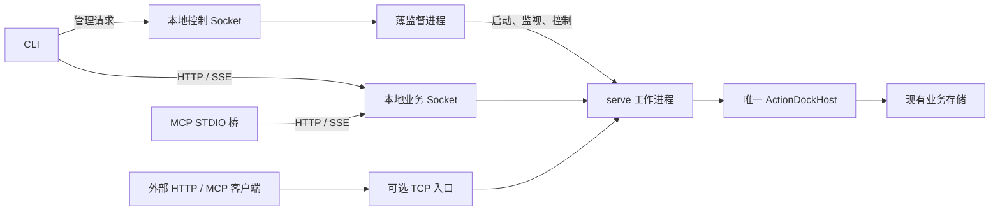

## 背景

本地调用需要共享长期存活的运行服务。
异步任务不依赖提交命令的生命周期。
该服务为定时任务和共享连接提供运行基础。
实现复用现有 `ad serve`，不另建动作运行平台。

现有实现具备主要业务能力，但进程和传输方式需要调整：

- [CLI 服务装配](../../packages/cli/src/utils/target.ts) 的本地分支创建 Host，调用结束后关闭。
- [运行命令](../../packages/cli/src/commands/run.ts) 拒绝本地异步提交。
- [serve 命令](../../packages/cli/src/commands/serve.ts) 已装配 Host、HTTP 路由和 MCP 端点，但在前台运行。
- [MCP STDIO](../../packages/mcp/src/stdio.ts) 默认创建运行子进程，也支持注入已有服务。
- [HTTP 服务端](../../packages/core/src/server/http-server.ts) 目前只装配 TCP 地址。
- [普通客户端请求](../../packages/core/src/client/transport.ts) 与 [SSE 请求](../../packages/core/src/service/sse-stream.ts) 都需要增加本地 Socket 传输支持。
- [统一服务接口](../../packages/core/src/service/types.ts) 已包含发现、运行、运行记录、事件和配置状态能力，可以直接复用。

本次设计采用薄监督进程托管一个 `serve` 工作进程。
本地消费命令默认自动发现、启动并连接该服务。
系统不要求用户指定 daemon 地址、TCP 端口或重复传入 `--daemon`。

本期交付后台启动、即时错误恢复、本地无端口通信、统一调用和可选 TCP 入口。
本期不实现 Action 平台、自动安装与定时调度。
本期不实现通用共享资源接口与进程池。
本期不实现零中断热替换或完整自升级系统。
这些能力不进入监督进程。

以下命令和机制均为尚待实现的目标设计。
建议分支为 `feature/local-resident-host`，不是已有分支声明。

## 整体设计

### 两个后台进程，一个运行宿主

每个 ActionDock 用户目录最多运行一个监督进程和一个受其管理的 `serve` 工作进程。
用户目录遵循现有 `customHome` 规则，不固定为某个操作系统路径。



监督进程只处理生命周期。
监督进程不装载 Action，不创建 Host，不打开业务数据库。
监督进程不转发普通业务请求。
CLI 和 MCP 完成发现后直接连接工作进程。

工作进程复用现有 `serve` 业务装配。
工作进程拥有唯一 Host、运行服务、业务存储和事件流。
本地 Socket 与可选 TCP 监听共享该 Host。
系统不存在独立网关进程。
系统不为每次调用派生 `ad run` 子进程。

### 监督职责

监督进程只承担以下职责：

- 启动工作进程并等待就绪。
- 监视进程退出，区分意外崩溃、主动停止与受控重启。
- 意外退出时采用有上限的退避重启。
- 连续失败后进入可查询失败状态，禁止无限重启。
- 转交受限控制请求，包括状态查询、停止、重启与启停 TCP 入口。
- 在内存中保留当前启动参数，供工作进程恢复使用。

工作进程负责判断 Action 是否繁忙。
工作进程负责处理任务取消与数据库关闭。
监督进程不创建独立任务表、任务标识或运行状态机。

## 详细设计

### 命令行为

目标解析为本地后，本地消费命令默认连接后台服务。
远端 Profile、服务地址与现有目标解析优先级保持有效。
远端连接失败时不回退到本地。
项目初始化、检查、构建和测试仍使用原有工程链路。
系统不为这些命令启动服务。

目标调用形式如下：

```bash
# 自动发现或后台启动，等待本次结果
ad run team4u.github-tools/list-pr -- owner=team4u

# 提交到同一服务，取得业务 runId 后返回
ad run team4u.github-tools/list-pr --async -- owner=team4u
ad runs list
ad config list -P team4u.github-tools

# 只是保持 MCP 协议会话，不另建运行 Host
ad mcp

# 确保后台服务就绪，开启 TCP 入口，输出地址后返回终端
ad serve
ad serve --port 8080 -P team4u.github-tools

# 只关闭 TCP 入口，不关闭本地服务和后台任务
ad serve stop

# 预启动与显式管理，通常无需手动 start
ad daemon start
ad daemon status
ad daemon restart
ad daemon stop
```

`ad daemon status`、`stop` 与 `ad serve stop` 不因查询或停止请求而启动服务。
`ad daemon stop` 表示停止本次后台运行，不写入永久禁用状态。
下一次普通本地调用仍可重新启动后台服务。

源码调试通过直接运行入口保留工程语义。
`ad run --direct` 在当前进程运行。
`ad serve --foreground` 用于前台调试。
这些调试命令不进入监督循环。
这些调试命令不能与后台服务无协调地持有同一存储域。
直接运行与显式远端目标互斥，不作为连接失败时的自动回退。

普通本地调用不因当前目录存在同名项目而替换后台实现。
未链接源码需要显式开发运行，不能静默使用另一份同名代码。

### 包选择与启动参数

不指定包时，工作进程装载启动时全部已链接包。
指定包时只选择相应根包与运行所需依赖。
未知或空的显式参数返回错误，不回退为全部包。
依赖发现、动作解析与命名绑定继续复用包图和调用规则。
系统不根据 `uses` 将纯远端实现装到本地。

服务装载范围和入口过滤分开处理。
`ad daemon start --package <ids...>` 可以限定服务根包。
已有服务上的 `serve -P`、动作白名单和 MCP 包选择只收窄入口范围。
已有服务不临时装载新包，也不重建 Host。
服务缺失时，普通调用按默认全部已链接包启动。
入口筛选随后生效。

省略所有筛选时，高层命令使用当前服务公开的全部能力。
显式动作或视图限制存在时，不能因省略包参数而额外授予全部包。
底层白名单保持“空即不授权”规则。
命令层负责明确构造所需范围。

包集合在工作进程启动时形成快照。
全部模式下，新链接在工作进程下次启动或崩溃恢复时生效。
指定模式不会因其他链接增加而扩大范围。
运行中不做逐文件热装载。

监督进程在内存中保留启动规格与已应用的 TCP 入口参数。
工作进程恢复使用同一规格。
引用的用户配置文件仍是配置事实源。
系统不把文件内容复制到新的服务状态数据库。
服务已运行时，命令只提出入口或查询需求。
命令不能借启动参数改变既有根包、数据目录或环境。

工作目录和环境采用启动规格，不随请求全局修改。
相对启动路径在客户端规范化。
CLI 的输入文件和 stdin 先在客户端读取。
需要调用者目录语义的业务应显式传入路径。
系统不为并发请求调用 `process.chdir()` 或改写 `process.env`。

### 本地发现与传输

本地通信不使用固定 TCP 端口。
本地通信不扫描端口，不依赖记录随机端口的文件：

- Linux 与 macOS 使用 Unix Domain Socket。
- Windows 使用命名管道。
- 控制端点和业务端点使用不同的本地地址。
- 本地地址由当前用户与规范化用户目录推导得出。
- 控制端点服务监督进程，业务端点服务工作进程。
- Unix 地址存放在用户私有运行目录下，采用短路径以满足平台限制。
- Windows 管道名包含用户与目录身份，避免不同环境碰撞。

两个本地端点均可承载 HTTP。
工作进程继续提供现有 HTTP/SSE 业务协议。
控制端点只提供有限生命周期操作。
控制端点不提供任意命令运行或业务转发。

客户端显式区分本地 Socket 连接与远端 HTTP URL。
Node 的 `fetch()` 默认不支持 `unix://`。
统一请求边界增加本地传输适配。
适配范围覆盖 JSON、SSE、流式响应、取消与连接释放。
事件流与普通请求均接入本地传输。

连接时检查端点角色、用户目录身份、协议及实例标识。
连接使用当前会话凭据认证。
Socket 存在、PID 存活或健康响应不能代替身份验证。
凭据通过用户私有运行文件引导。
凭据不进入命令行参数、普通输出、日志或对外响应。

私有目录和文件检查属主、权限与类型，拒绝非预期符号链接。
Unix 使用受限文件权限。
Windows 使用用户隔离的管道访问限制并保留应用层认证。
系统不能仅依赖管道名称保障安全。

遇到地址占用时，先检查是否为同一服务。
确认旧实例已退出且租约可回收后，清理失效 Socket。
对存活、身份不符或状态不明的实例返回明确错误。
系统不直接删除地址或启动竞争服务。
Windows 管道按平台句柄生命周期处理，不套用文件删除逻辑。

### 后台启动与错误恢复

客户端先连接控制端点。
需要启动监督进程时竞争启动互斥，取得互斥后再次检查。
监督进程自身持有实例租约，随后启动唯一工作进程。
并发冷启动不能产生两个业务存储持有者。

监督进程通过当前 Node 二进制文件启动内部前台模式。
监督进程使用明确的 ActionDock 入口启动工作进程。
系统不使用 Shell 拼接命令，不从 `PATH` 寻找全局 `ad`。
启动过程不再次触发公开命令的后台启动逻辑。

后台进程脱离触发命令的标准输入，输出写入有界日志。
父子控制复用 Node IPC，只传递白名单消息和结构化参数。
工作进程通过 IPC 报告就绪，不通过解析终端文本判断成功。

就绪判定分为两层：

- 本地就绪要求完成包发现、业务存储准备与本地 Socket 监听认证。
- TCP 入口拥有独立的监听结果。
- TCP 入口失败不影响已就绪的本地服务。

触发命令只等待对应结果，等待过程有界且可取消。
返回终端不代表工作进程退出。
取消等待不代表服务死亡，不能据此启动新实例。

工作进程非正常退出后，监督进程检查旧进程与关联状态。
满足恢复条件后，监督进程按原规格退避重启。
监督进程不等待下次客户端调用即可触发恢复。
持续配置错误或重复崩溃达到重试上限后停止循环。
系统保留失败原因，等待显式修正或重试。

工作进程与监督进程的 IPC 意外断开时，工作进程停止接收新任务。
工作进程完成有界退出，避免残留无人管理的运行宿主。
新监督进程不能因控制 Socket 消失而抢占在用业务数据。

本期不递归监督监督进程自身。
监督进程退出后，后续客户端可以重新启动监督进程。
系统不保证无人调用时自动恢复监督层，不提供开机自启能力。

### TCP 入口与生命周期隔离

本地业务 Socket 始终独立于对外 TCP 入口。
`ad serve` 通过控制端点请求同一工作进程开启 TCP 监听。
系统不创建网关子进程或第二个 Host。
第一阶段管理一个可选 TCP 入口，虚拟视图复用现有能力。

TCP 入口沿用监听地址、端口、TLS、鉴权、视图与请求限制配置。
默认端口沿用 `5177`，仅用于可选入口，不用于本地服务发现。
非回环监听必须按安全边界明确鉴权。

重复请求同一入口配置时幂等返回已有地址。
不同配置不能静默覆盖在用入口，需要明确停止或重新配置。
配置失败不会丢失已成功运行的入口。
端口占用时返回准确错误，不自动切换端口。
端口占用不终止本地 Socket、Host 或异步任务。

`ad serve stop` 只关闭 TCP 监听及其会话。
TCP 入口的同步请求依取消规则收尾。
已接受的异步任务和其他客户端继续运行。
本地业务 Socket、监督进程和 Host 不随之关闭。

系统拆开 HTTP 请求处理、监听器和 Host 生命周期。
两个监听器共享业务服务，关闭某个监听器不得级联关闭 Host。
[现有服务停止](../../packages/core/src/server/server.ts) 会关闭传入服务。
[网络层关闭](../../packages/core/src/server/http-server.ts) 会关闭活动连接。
系统不能直接将单入口 `stop()` 当作入口关闭操作。

入口控制请求串行处理。
工作进程确认成功后，监督进程更新内存记录。
控制失败或中途断链不能视为已应用。
工作进程崩溃恢复时，按最后确认的配置尝试重新开启入口。
恢复时端口冲突只将该入口标为失败，本地运行仍可恢复。
显式关闭成功后不再恢复。
监督进程退出后，系统不恢复上次命令行开启的入口。
用户可以重新运行 `ad serve` 或指定明确的配置来源。

### 同步、异步与 MCP

CLI 和 MCP 直接访问工作进程的服务端口。
同步调用等待本次结果，取消操作仅作用于当前请求。
本地命令退出不能关闭 Host。

异步调用复用 `ExecutionPort.start()` 并返回业务 `runId`。
监督进程不创建其他后台任务凭据。
监督进程不将异步 Action 转为新的 CLI 子进程。
后续查询、订阅和取消均访问同一工作进程。

[现有客户端](../../packages/core/src/service/remote.ts) 的 `start()` 立即观察结果。
客户端的 `close()` 目前仅配置关闭标记。
系统改为按需观察结果。
客户端关闭时释放 Socket、SSE、轮询和定时器资源。
客户端关闭不取消服务已接受的异步任务。

普通调用的预连接失败时可先恢复服务。
服务一旦接收请求，断链只能报告结果未知。
系统禁止在重连或错误恢复后自动重发请求。
系统保留已有 `runId` 或 `requestId` 供查询。
业务记录恢复不等于重新运行业务。

MCP STDIO 随客户端维持协议连接，仅作为适配桥。
MCP STDIO 注入本地服务连接，不再启动独立运行 Host。
初始化失败、EOF、信号和会话关闭统一回收桥接连接。
桥接连接关闭时不越权关闭服务。
工作进程实例变化时旧 MCP 会话结束。
客户端重新发现工具，不在旧契约下静默更换实例。

TCP HTTP 与内置 MCP 端点在同一工作进程内完成鉴权。
工作进程依据现有规则创建运行来源。
本地 MCP 桥通过用途受限的连接标识为 `mcp` 来源。
该标识由服务端配置决定。
系统禁止普通请求体或请求头提供完整 `RunOrigin`。
系统不引入跨网关来源转交协议。

### 停止、重启与数据所有权

监督进程为主动停止和计划重启配置明确意图。
监督进程不把工作进程的正常退出误判为崩溃重启。
工作进程负责运行接入门禁和安全停止判定。

存在活跃任务时，默认停止或计划重启返回忙碌状态。
默认停止操作不取消活跃任务。
同一门禁协调状态检查与接收新提交。
门禁覆盖正在登记的异步提交。
检查失败后恢复接收提交。
门禁不能误拒绝已有 Action 的内部依赖调用。
显式 `--force` 请求取消并完成有界清理。
强制停止不代表能回退业务副作用。
宽限期耗尽不代表旧进程已停止。
进程存活时保留失败诊断和租约限制。
系统不能报告正常停止，也不能立即启动替代实例。

停止单个入口与停止整个服务属于不同操作。
服务停止时先禁止新提交，再处理在途操作与任务。
随后关闭数据流、监听器、存储和租约。
事件观察不阻止退出，配置与状态写入须纳入关闭屏障。

业务数据沿用现有存储路径。
包库默认位于 `~/.actiondock/data/<package-id>/runtime.db`。
全局库默认位于 `~/.actiondock/global.db`。
路径计算以 [现有存储模块](../../packages/core/src/storage/index.ts) 为事实源。
监督进程不复制配置库、状态库或运行库。
系统不通过创建 `dataDir` 移动全局库。

只有工作进程持有业务存储租约。
监督进程只持有实例管理租约。
存储所有权按规范化数据库路径互斥，覆盖包库与全局库。
系统不按用户目录或 `dataDir` 参数创建彼此无关的锁。
不同用户目录命中同一业务库时必须产生冲突。
多个路径租约按固定顺序获取。
任一租约获取失败时释放已取得的租约。
系统对默认路径补充排他保护。
系统不能仅依赖 [Host 当前对显式 dataDir 的锁](../../packages/core/src/host/host.ts)。
直接运行或前台调试须使用独立存储域。
直接运行可在后台服务停止后获取同一存储域所有权。
直接运行不能绕过租约机制。

非正常退出后的运行记录收敛复用现有机制。
子进程存活保护复用现有机制。
旧实例未确认退出、租约未回收或子进程存活时，系统不启动第二宿主。
系统不强行删除租约锁，不自动重放旧任务。

### 最小运行信息

监督进程仅在内存中维护启动参数、当前进程、重启计数与 TCP 入口配置。
系统不新增 `daemon/config.json` 文件。
系统不新增入口状态数据库或任务数据库。

私有运行目录允许存储实例租约、会话凭据、进程身份和有界日志。
这些信息用于发现、认证、互斥与排障，可以重建。
磁盘中的运行状态字段不能代替进程、IPC 和健康验证。

用户提供的视图文件、证书和业务配置沿用原机制。
系统不另行存储上次成功的服务配置。
系统不自动将终端环境变量持久存储。
工作进程重启可使用监督进程内存中的参数。
机器重启后的完整环境恢复不属于本期保证范围。

### 热加载与 ad 自身更新的边界

本期提供受控重启边界，不实现进程内模块热替换。
[现有模块加载器](../../packages/core/src/platform/module-loader.ts) 使用普通 ESM 缓存。
工作进程重建后自动清理运行代码缓存。
系统不把文件覆盖或重新 `import()` 视为完整热更新。

后续代码更新可在独立目录准备。
通过检查后，请求安全重启。
更新准备失败时保留当前实现。
活跃任务未结束时延后切换。
当前进程不混用已覆盖的程序文件。
重启会断开 WebSocket 等进程内连接。
客户端需要重新连接。
系统不承诺无感迁移或自动重发业务消息。

`ad` 升级涉及监督进程。
重启工作进程不代表整套程序已完成升级。
后续更新器独立完成监督层交接、就绪确认与错误恢复。
更新器负责检查协议和存储兼容性。
回退代码不代表回退数据。
本期不实现自动下载、静默应用策略与发布渠道。
本期不增加 Action 版本协商机制。

## 模块影响

薄监督与命令入口作为 CLI 内部生命周期模块实现。
系统不新增运行框架包。
监督代码不得依赖 Action 装载、任务状态机或业务数据库。

`core` 继续承担 Host、运行、存储和 HTTP 协议。
`core` 补齐本地 Socket 与命名管道传输能力。
`core` 统一 JSON 与 SSE 的请求边界。
`core` 支持监听器与 Host 独立关闭。
`core` 提供默认存储域租约与停机协作支持。

CLI 统一处理发现、连接与默认本地目标。
CLI 覆盖 `run`、发现、Playbook、配置、状态及运行查询取消路径。
`serve` 公开命令改为后台控制入口。
内部前台模式复用原有服务装配，避免启动递归。

MCP 复用连接注入与协议适配。
`sdk`、Action 定义与现有业务运行标识保持不变。
Builder 交付模式保持不变。
独立 Node 交付产物按自身生命周期运行。

## 发布与恢复

系统先交付 Socket 传输、租约和后台启动能力。
随后接入 CLI 命令、MCP 命令及 TCP 入口控制。
完成冷启动、连接清理、停止竞态和端口冲突测试后，切换默认入口。

这是本地运行默认行为的调整。
消费命令改连常驻服务。
源码调试需要显式指定直接运行入口。
`serve` 默认后台返回。
MCP STDIO 继续保持协议会话。
用户目录、远端 Profile 选择与业务存储格式保持不变。

切换前须停止使用同一数据的旧版 `serve`。
切换前须停止旧版 MCP 运行宿主与直接运行实例。
旧版本不支持新租约，不能跨版本保证并发安全。
原有配置和状态直接沿用，无需迁移或复制目录。

本地 Socket 默认能力范围来自已链接根包。
对外暴露服务如需更窄权限，应显式选择包、动作或视图。
全部模式在工作进程恢复时纳入新链接。
省略参数不代表永久固定的包清单。

交付时同步更新对应说明文档：
- `skills/actiondock/SKILL.md`
- `references/cli.md`
- `references/consumer.md`
- `references/troubleshooting.md`

文档须说明后台返回、源码开发、认证、本地连接与错误恢复。
本文档不将未实现的命令作为可用接口。

出现重复宿主或误取消任务等问题时，停止推广并停机排查。
回退前先处理活跃任务，停止工作进程与监督进程。
随后恢复旧版 CLI 与 MCP 启动方式。
业务库格式未修改，无需跨目录合并数据。
已产生的外部副作用不会因回退而消失。

## 测试

以下是实施时的验证要求，不代表当前已实现或测试通过：

- 并发冷启动：多个本地命令同时触发启动。系统只产生一个监督进程和一个工作进程。所有客户端连接相同实例。
- 后台行为：`ad serve` 和异步提交在就绪后返回终端。关闭终端不终止后台服务。同步命令仍等待本次业务结果。
- 启动递归：工作进程使用内部前台入口。工作进程只装配一次 Host。工作进程不再次派生监督进程或工作进程。
- Socket 传输：请求、SSE、取消和关闭在不同平台行为一致。本地启动不绑定或扫描 TCP 端口。
- 实例身份：错误角色、用户目录、协议、令牌或属主均拒绝访问。系统确认残留 Socket 可回收后才清理。系统不删除存活或未知实例。
- 包范围：省略参数时装载全部已链接根包。显式指定子集时不扩大范围。输入未知包名时返回错误。默认全包授权不覆盖动作筛选。
- 错误恢复：工作进程崩溃后按原规格退避恢复。无新客户端调用时也会自动恢复。连续失败达到上限后停止重试。主动停止与计划重启不触发拉起。
- 监督退出：IPC 断开后工作进程退出。旧实例或关联进程存活时，新实例不抢占数据。
- TCP 冲突：预占指定端口后启动对外入口，系统返回明确错误。本地调用和已有异步任务继续运行。系统不自动更换端口，不关闭 Host。
- 入口关闭：关闭 TCP 监听不关闭本地 Socket 和 Host。关闭 TCP 监听不影响其他客户端任务。工作进程恢复时重开入口失败，不影响本地就绪。
- 同步与异步：取消同步请求不影响其他任务。异步调用返回原有 `runId`。客户端退出后无残留观察资源。关闭事件观察不取消任务。
- MCP 生命周期：断开桥接不关闭宿主。实例变化后旧会话重新发现工具。普通输入不能伪造公开 HTTP 或 MCP 来源。
- 停止竞态：异步提交与停止并发时不遗漏任务。默认返回忙碌状态且不取消任务。强制停止时请求取消任务。按生命周期清理在途写入与流。
- 数据所有权：沿用旧配置、状态和运行记录。命中相同业务库时受所有权保护。获取多个租约失败时完整释放已取得租约。锁配置不移动全局库。
- 无业务重放：切断连接或终止服务后，客户端不自动重新提交。错误恢复只收敛运行记录，保留关联标识。
- 最小状态：清理失效运行信息不删除业务数据。监督进程重启不恢复失效入口配置。系统不引入独立任务或配置数据库。
- 发布回退：停止新后台进程后，旧运行方式继续读取业务数据。切换前禁止旧版与新版并发持有相同存储域。

生命周期逻辑使用注入的时钟和进程边界验证。
Socket、命名管道、权限、信号和 SSE 使用集成测试验证。
