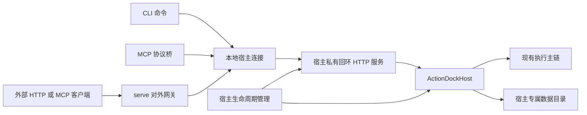

## 背景

当前本地调用通常由客户端进程创建执行宿主，调用结束后关闭宿主。`ad run` 的本地分支不支持异步提交；MCP STDIO 默认创建自己的执行子进程，并在客户端断开后清理；`ad serve` 也会创建自己的执行服务。不同入口虽然复用相同执行引擎，却没有共享同一个长期存活的执行目标。

现状依据：

- [CLI 服务装配](../../packages/cli/src/utils/target.ts) 的 `withService()` 在本地分支创建服务，并在调用结束后执行 `close()`。
- [Action 调用入口](../../packages/cli/src/commands/run.ts) 拒绝本地 `--async`。
- [MCP STDIO](../../packages/mcp/src/stdio.ts) 默认启动 IPC 子宿主；注入外部 `service` 时可以仅承担协议适配。
- [HTTP 服务命令](../../packages/cli/src/commands/serve.ts) 自建执行服务，再把该服务同时交给 HTTP 路由及 MCP 端点。
- [统一服务契约](../../packages/core/src/service/types.ts) 已包含发现、执行、事件、运行记录及配置状态端口；[HTTP 服务](../../packages/core/src/server/server.ts) 和 [HTTP 客户端](../../packages/core/src/service/remote.ts) 已提供跨进程访问基础。

本次设计新增显式启用的用户级本地常驻宿主，使 CLI、MCP、HTTP 服务入口和运行查询访问同一份执行服务。宿主生命周期不依赖某个客户端连接或网关进程，异步任务可以在提交命令或对外入口退出后继续执行。

本阶段不包含 Action 平台、自动安装、自动更新、定时任务、共享资源接口、热重载、执行进程池、系统开机自启或无人值守运行保障。不增加 Action 版本协商，也不改变 Action 编写方式。

本文描述尚待实现的目标设计，新增命令和配置不能作为当前使用方法。建议分支为 `feature/local-resident-host`，该名称仅为建议。

## 整体设计

### 一个宿主，多种客户端

每个 ActionDock 用户目录维护一个本地常驻宿主。不同用户目录用于测试或显式隔离；同一目录不能同时运行多个实例。



本阶段采用单个独立进程承载私有 HTTP 服务和现有 `ActionDockHost`。客户端和网关通过已有 HTTP/SSE 协议连接，不新增执行 RPC，不在 CLI、MCP 桥或 `serve` 网关中再次创建本地 Host。对外监听进程不计入执行宿主数量，可以有多个入口共享同一宿主。

常驻进程的标准输入不连接客户端，标准输出和标准错误写入宿主日志。MCP STDIO 进程只承载 MCP 协议流，因此 Action 的错误输出不会写入 MCP 的标准输出。

该结构接受同一进程的故障域：Action 若直接终止进程，宿主也会退出。本阶段只运行用户信任的本地代码，不提供安全沙箱。后续可以在统一服务接口后增加执行隔离，但本期不提前引入监督进程与执行进程池。

### 职责和所有权

- 宿主进程拥有 `ActionDockHost`、业务存储、执行事件及受管进程的生命周期。
- CLI 拥有自己的 HTTP 请求、结果等待及事件订阅，不拥有宿主。
- MCP 协议桥拥有 MCP 会话及本桥接连接；一个 MCP 客户端退出不能关闭其他客户端使用的服务。
- `serve` 网关拥有对外监听、TLS、入口鉴权、视图和上游连接，不拥有执行宿主或业务存储。网关退出不关闭宿主，宿主停止也不由网关生命周期隐式决定。
- 生命周期管理负责启动、就绪发布、状态查询和停止；这些能力不加入 `ExecutionPort`。

现有 `ActionDockService` 继续作为业务接口。客户端连接的 `close()` 只释放本客户端资源；关闭服务端宿主必须经过独立的管理操作。

## 详细设计

### 显式入口与目标选择

第一阶段通过新增 `--daemon` 显式选择常驻宿主，不改变未带该选项的现有命令。

以下为目标调用形式：

```bash
# 默认装载全部已链接包，保存这一选择模式
ad daemon start

# 同一宿主中的发现、执行与运行管理
ad describe team4u.github-tools/list-pr --daemon
ad run team4u.github-tools/list-pr --daemon -- owner=team4u
ad run team4u.github-tools/list-pr --daemon --async --request-id review-job -- owner=team4u
ad runs list --daemon
ad config list -P team4u.github-tools --daemon

# MCP 默认使用宿主已公开的全部包
ad mcp --daemon

# 对外 HTTP 与内置 MCP 默认使用同一能力集合
ad serve --daemon --port 5177

# 状态查询不启动宿主
ad daemon status
ad daemon stop
```

目标选择遵循以下规则：

- `--daemon` 与显式 `--profile`、`--server` 互斥，冲突时报参数错误。
- 显式 `--daemon` 不使用环境变量或当前 Profile 选择其他顶层执行目标，也不改写当前 Profile。Action 内部的命名绑定仍按执行宿主的现有规则解析。
- 未指定 `--daemon` 时保持现有本地、远端与源码开发行为；远端失败不回退到常驻宿主。
- `ad daemon start` 省略 `--package` 时选择全部已链接包；指定该参数时只选择给定包及执行所需依赖。
- `serve`、MCP 和发现查询省略所有能力筛选时，不增加筛选，使用宿主已经公开的全部能力；显式包、动作或视图限制仍然生效。未传包参数不能抵消已传动作筛选，也不能被解释为空授权集合。
- 常驻模式中的 `-P` 是包标识选择，不接受用于临时装载源码目录的路径。显式给出无效、空或未知包参数时报错，不能退回全部包。
- 常驻模式不接受单次命令指定另一个 `--data-dir`。需要隔离时使用独立 ActionDock 用户目录，而不是让一个连接改变运行中宿主的数据目录。
- `ad serve --daemon` 表示基于常驻宿主启动对外协议网关，不创建执行 Host，也不承担宿主控制。该模式拒绝 `--dir` 临时装载工程；包和动作参数只筛选宿主已经公开的能力。
- 项目创建、测试、构建和依赖修改命令仍在现有开发链路执行。未带 `--daemon` 的 `serve` 暂保留直接运行语义，作为第一阶段的兼容入口，而不是从常驻架构中排除 `serve`。

CLI 的目标解析与连接装配应收敛到共享入口。`info`、Playbook 查询、运行取消和 `serve` 装配等现有独立分支也必须接入，不能只有 `run` 使用常驻服务。

### 装载配置与执行环境

用户执行 `ad daemon start` 即选择全部已链接包作为公共根包；需要缩小范围时使用 `ad daemon start --package <ids...>`。这里的全部只指现有本地注册表登记的包，不扫描磁盘任意工程，不因为调用者位于某个项目目录就装载该项目，也不下载缺失实现。

选择模式保存为 `~/.actiondock/daemon/config.json`：配置区分“全部已链接包”和“指定包列表”，并记录固定工作目录，不能仅用空数组混淆两种意图。全部模式在每次实际启动时读取注册表形成包集合快照；指定模式只解析保存的包标识。实际包路径也在启动时解析，构成本次实例的批准集合。目录需按现有 `customHome` 规则定位，不能自行硬编码操作系统家目录。

启动装配复用包发现与 `PackageGraph`，准备所选包需要的本地依赖。无论哪种选择模式，选中根包解析失败、依赖缺失或包身份冲突时均启动失败，不静默遗漏。注册表确实为空时允许启动空宿主，状态明确显示没有公开包；显式指定未知包不属于这种情况。HTTP 入口只授权本次批准的公共根包；装载依赖不等于额外授权客户端直接调用依赖包。远端命名绑定继续由现有调用链处理，不能据 `uses` 全量装载本地实现。

运行期间不根据 CLI 的当前目录临时增加包。注册表、包清单、绑定或实现发生变化后，通过显式重启应用；不提供热重载保证。全部模式下新增链接在下次实际启动时进入批准集合，指定模式下新增其他链接不扩大范围。对同一选择模式重复执行 `start` 不重新扫描或热装载；已运行实例遇到不同装载配置的 `start` 请求时返回配置冲突，不隐式重启。

宿主工作目录固定，默认使用其私有运行目录；环境变量取宿主启动时的环境。本期不模拟每个 CLI 进程的 `cwd` 或完整环境变量，不为请求调用 `process.chdir()`，也不修改全局 `process.env`。Action 内的相对业务路径按宿主工作目录解释，需要调用者目录语义的操作必须传入明确路径。CLI 自己读取的 `--input-file` 和标准输入仍在客户端解析后传送。

配置沿用现有解析规则，单次 `-c` 覆盖可以传给宿主。后续终端环境变化不会自动改变已运行宿主；持久凭据建议通过常驻模式的配置命令管理。

### 数据目录与权限

常驻宿主使用独立数据目录，避免与旧的直接运行模式无协调地写入同一份业务存储：

```text
~/.actiondock/daemon/
  config.json
  endpoint.json
  auth.json
  daemon.log
  data/
```

- `data/` 显式传入 Host，使现有 `DataDirLock` 确实生效。包级库和全局库均按现有 `dataDir` 规则落在该目录内。
- 旧的默认数据库不复制、不移动，也不隐式读取。启用常驻模式后，配置、状态和运行历史属于独立环境，查询与修改必须携带相同目标选项。
- 私有目录限制为当前用户访问，认证文件限制为当前用户读写。POSIX 使用目录 `0700`、文件 `0600`；其他平台必须提供等效的用户访问限制，无法保证时拒绝启动，不能静默放宽。读写端点、认证与租约前核对属主和权限，拒绝关键文件的非预期符号链接；用户目录先规范化，再确定实例身份和文件边界。
- 日志有界轮转；宿主状态和命令输出不包含认证令牌，不把启动环境或完整敏感配置写入日志。

[现有存储路径](../../packages/core/src/storage/index.ts) 在默认模式下按包共享，而 [Host 初始化](../../packages/core/src/host/host.ts) 只在显式设置 `dataDir` 时获取目录排他锁，因此不能把现有默认模式当作已经具备统一宿主所有权。

### 启动、发现与就绪

新增 `ad daemon start`、`status`、`stop` 和 `restart`。无配置时，普通 `--daemon` 调用返回未配置错误，引导用户先执行 `ad daemon start`，无需逐包列举；存在已确认配置时，普通调用可在宿主确定不存在的情况下按保存的选择模式自动启动，不把指定模式改为全部模式。

`status`、`stop` 不自动启动宿主。用户手动执行 `start` 且未传包参数时，请求全部已链接包模式；对相同配置的就绪实例幂等。`restart` 复用停止和启动流程，并保留保存的选择模式，不绕过活跃任务检查。

冷启动流程为：

- 客户端读取端点描述，尝试带认证信息验证实例身份与就绪状态。
- 需要启动时竞争启动互斥，取得互斥后再次检查，避免重复派生进程。
- 新宿主取得实例排他租约，创建 Host 并取得业务数据目录锁；父进程意外退出也不能导致多个执行宿主同时成功。
- 宿主仅绑定 `127.0.0.1`，使用系统分配的可用端口。完成包装配、资源准备及监听后，才原子发布 `endpoint.json`。
- 新宿主在进程内生成本实例的认证凭据，以受限权限原子写入 `auth.json`，不通过启动参数或日志传递令牌；凭据准备完成后才发布端点。只有持有实例租约的宿主可以更新这些文件。
- 端点描述包含规范化用户目录的身份摘要、实例标识、进程标识、协议标识、实际端口、配置摘要和启动时间，不包含令牌。客户端必须通过带认证的状态接口确认用户目录身份、实例标识和协议一致，不能只检查 PID 或端口能否连接。
- 等待启动有界且可取消。启动失败必须回收本实例已创建的资源，并保留可定位的错误；清理锁和描述文件时比对本实例标识，不能删除后来启动实例的记录。

启动等待超时不等于宿主已死亡。对仍存活或无法确认状态的进程，不清锁、不再派生竞争实例。端点损坏、鉴权失败、身份不符或协议不兼容时失败关闭，不能回退为进程内执行。描述中的地址必须验证为规定的回环地址和路由，不接受重定向或任意远端地址。

实例异常退出后，下一次明确的常驻调用可以重新启动。遗留运行收敛及存活子进程保护复用现有恢复逻辑；有存活子进程时继续返回恢复要求，而不是强删锁。无论启动还是恢复，都不重新提交旧业务操作。

### 本地 HTTP 接口与执行来源

业务访问继续使用现有 `/api/v2` HTTP/SSE 路由。生命周期管理增加独立的状态和停止接口，不通过 Action 实现自身停止，也不向 MCP 暴露宿主控制工具。

私有本地监听同样强制 Bearer 鉴权，不开启查询串令牌，不开放浏览器跨域访问。宿主为 CLI、MCP 桥和 HTTP 网关分配用途受限的认证连接：CLI 可访问批准包及配置状态；MCP 桥只访问发现、执行和运行观察；HTTP 网关按其显式启用的管理能力连接。生命周期控制只接受管理侧认证，不对外转发。

MCP 和 HTTP 网关均可在宿主批准集合内进一步限制能力，不能请求扩大宿主的批准集合。认证视图不是代码沙箱，不能阻止已授权 Action 内部执行其获准依赖。

需要补齐桥接后的来源语义：CLI 和对外 HTTP 触发的运行记录为 `http`；MCP 桥及 `serve` 的 MCP 端点触发的运行记录为 `mcp`。直连来源由宿主的认证连接配置生成；网关来源由实际完成入口鉴权的适配器生成，通过持有专用本地桥接凭据的连接转交，宿主校验来源结构和连接允许的来源范围。外部请求体与普通请求头不能直接设置或覆盖该对象。

网关转发时保留对外入口的 `viewName` 和 `authenticated`，不能把内部回环连接已认证误记为外部调用已认证。普通远端客户端继续不能任意转发完整 `RunOrigin`；来源转交只属于明确授权的本地桥接通道。现有 HTTP 执行路由固定生成 `http` 来源，HTTP 客户端也未转发该上下文，因此这项能力需要实现，不能认为注入服务就自动保留来源。

核心 HTTP 实现应提供可复用的请求处理装配，使 daemon 能组合管理路由、状态门禁与业务路由，不复制现有路由和鉴权逻辑。`serve` 网关继续复用通用业务路由，直接运行模式的默认行为保持不变。

### 同步、异步与连接关闭

同步 `run` 保持请求级协作取消：CLI 中断或 MCP 请求取消时，取消信号传到该次 Action；其他客户端任务不受影响。连接异常时可能拿不到最终业务结果，不据此自动重新执行。

异步 `start` 在任务被接收后独立于提交连接存在。CLI 输出票据即可退出；后续通过运行查询、事件订阅或取消接口继续管理。关闭观察连接不等于取消后台任务，只有显式取消操作才请求终止任务。

现有 HTTP 路由已经区分同步请求信号与异步提交，但 [HTTP 服务客户端](../../packages/core/src/service/remote.ts) 的 `start()` 会立即启动结果观察，`close()` 目前仅设置关闭标记。本阶段必须补齐：

- 不消费票据结果的 CLI 提交路径不能留下阻碍退出的 SSE 或轮询；结果观察应按需启动。
- 客户端关闭时中止本客户端的请求和事件观察，释放定时器和订阅；不能因此取消已接收的异步任务。
- 查询、SSE 中断及客户端关闭的资源回收走同一条连接级清理链。
- 在创建执行请求前确认宿主就绪；请求一旦可能被接收，连接失败不能触发自动重发。返回结果未知语义，并尽可能携带已有 `runId` 或 `requestId` 供查询。

票据和幂等标识继续使用现有契约，不承诺故障场景下恰好执行一次。安装与业务重试策略不属于本期。

### HTTP 服务接入

`ad serve --daemon` 先连接并验证常驻宿主，再把连接适配为 `ActionDockService` 交给现有 HTTP 服务。该分支不调用 `createActionDock()`、不创建平台驱动或打开业务数据库，也不通过当前目录或注册表另外解析执行包。

宿主私有端口用于本机连接发现，对外网关端口用于稳定地址、非回环监听、TLS、独立令牌和虚拟视图。仅供本机调用时直接连接宿主即可，不需要为每个客户端额外启动一个 `serve`。需要对外暴露时才增加网关，不把宿主的私有控制端口直接公开。

网关未传包、动作或限制性视图参数时，默认使用宿主已经公开的全部能力；传入任一筛选时，按显式选择和现有授权组合规则生成入口范围，未传的包参数不额外授予全部包。`--package`、`--action` 与视图声明只能收窄宿主能力，不能越过本次实例的批准集合。启动时验证其引用存在且在允许范围内，不支持的能力使网关启动失败，不能回退到本地路径装载。网关不从当前项目隐式读取服务视图，视图通过显式参数或文件提供；多个网关可以分别开放不同子集，但仍共享宿主的执行配额、状态与运行记录。

入口鉴权、TLS、请求体限制、CORS 和视图由网关负责。配置状态接口仍默认关闭，只有显式启用并取得对应本地访问能力时才能转发。网关只代理规定的业务接口，不透传宿主生命周期路由或本地认证信息，也不把外部 `Authorization` 原样用作宿主凭据。

关闭网关只关闭其监听、会话及上游连接；网关已提交的异步任务继续运行，网关自己的同步请求按取消语义收尾，其他入口的任务不受影响。启动失败也只清理本网关资源。现有 `startActionDockServer().stop()` 会关闭传入服务，在该模式中传入的是连接而不是宿主，必须保证这次 `close()` 不越权关闭 daemon。

上游不可用时网关不再宣称业务就绪，不自建替代 Host，也不自动重发可能已被接收的调用。宿主实例变化后，需要重新建立连接并重建入口元数据；本阶段要求显式重启网关，不在旧 MCP 工具目录或旧入口上下文下静默换用新实例。

### MCP 接入

`ad mcp --daemon` 默认使用宿主已经公开的全部包；指定 `--package` 时只开放对应子集。该入口创建宿主连接后注入现有 MCP 适配层，绕过默认的 IPC 执行子宿主。桥接进程只持有连接，并在标准输入结束、传输关闭或收到退出信号时清理本连接。

注入的宿主不归适配器所有，但桥接进程创建的连接需要由桥接入口显式关闭，不能因为 `ownsService: false` 而遗漏本地 HTTP/SSE 资源。初始化失败、标准输入结束、传输关闭和退出信号均进入同一幂等清理链，清理请求、订阅和等待定时器。MCP HTTP 模式如选择常驻目标，也只增加协议适配，不另外创建执行 Host。

MCP 工具目录按桥接连接建立时的宿主实例生成。本阶段不提供工具热更新；实例身份变化时结束旧桥接会话，由客户端重连并重新发现工具。不得在旧工具契约下静默切换到新实例，更不能重放进行中的工具调用。

### 停止与恢复

默认 `stop`、`restart` 在存在活跃根任务时返回忙碌，不改变任务状态。需要取消现有任务时，用户显式使用 `--force`；强制停止表示请求协作取消并在宽限期内清理，不表示业务副作用可以回退。

停止检查必须与执行提交共用门禁。检查活跃任务之前先封闭新的根执行提交，并等待正在接收中的提交完成登记，避免异步任务已接收但尚未计入活跃集合的竞态。默认停止遇到忙碌时恢复接收；接受停止后不再接收新的业务请求。已运行 Action 的内部依赖调用不能在默认检查失败时被误拒绝。

查询和配置写入的在途请求也要纳入关闭屏障，事件观察连接不作为活跃任务阻止退出。停止接口先确认管理操作已接受，再开始关闭连接。强制停止先请求取消和收尾，再释放存储、关闭剩余流和 HTTP 服务，最后清理本实例的描述与租约。

不能直接照搬 [现有 HTTP 服务停止](../../packages/core/src/server/server.ts)：当前网络层会关闭活动连接，而 [执行服务关闭](../../packages/core/src/execution/service.ts) 会立即取消活跃任务。这与默认“忙碌时不影响任务”的目标不同，需要 daemon 自己协调停止门禁和顺序。

强制停止或进程崩溃时，客户端可能无法收到终态，应在宿主重新就绪后查询运行记录。仍有存活受管子进程时保留恢复限制，不把不完整清理报告为正常停止。

## 影响与模块边界

新增 `@actiondock/daemon` 承担用户级生命周期、配置与端点描述、连接发现、门禁和常驻进程入口，依赖 `core`，不依赖 Builder 或 MCP。CLI 负责把常驻连接交给业务命令、`serve` 网关及 MCP 适配器，避免反向依赖。

`core` 继续拥有包图、执行、存储、事件与通用 HTTP 协议；本期只补充可组合的 HTTP 装配、客户端连接清理及受服务端控制的来源转交等共享能力。桥接通道与普通远端连接明确区分，避免把可信上下文转交变成任意客户端伪造入口。宿主初始化所需的多包依赖装配继续复用现有包模型，不引入另一套动作解析器。

`cli` 在服务选择入口增加常驻分支，覆盖独立查询路径，并把异步提交、运行取消从“是否远端”判断改为“所选服务是否为可持续执行目标”。

`mcp` 保留直接运行方式，补齐桥接连接的生命周期。`sdk`、Action 定义、Builder 交付模式和现有项目依赖格式不改变。

未来定时任务或共享资源可以由常驻宿主承载，但必须拥有独立于客户端连接和单次 Action 的生命周期。本期不提前添加这些公共接口，也不通过关闭客户端来表达宿主空闲或资源释放。

## 发布与恢复

本阶段只新增显式入口，默认命令不切换执行目标。发布时先交付常驻进程和连接能力，再接入 CLI、`serve` 网关与 MCP；在连接关闭、停止门禁及故障恢复验证完成之前，不把常驻模式设为默认。

不迁移旧数据库，不改写用户当前 Profile，也不在旧入口中自动启用常驻模式。首次执行 `ad daemon start` 默认选择全部已链接包，用户可用 `--package` 缩小范围，并在独立环境设置必要凭据。全部模式包含后续实际启动时新登记的链接，因此对外网关需要更窄权限时应显式配置筛选和视图，而不是把省略参数理解为固定包清单。配置、CLI 新语法、取消语义和诊断方法在功能实现时同步更新 `skills/actiondock/SKILL.md` 及 `references/cli.md`、`consumer.md`、`troubleshooting.md` 等手册；设计文档不能替代可独立使用的技能指南。

出现任务重复提交、客户端退出误关宿主、配置写入错误环境或双宿主写入时，停止扩大使用范围并退出常驻模式排查。停止前先处理活跃任务；确需强制停止时明确接受取消及结果未知的可能。

恢复旧使用方式时，先关闭依赖该宿主的网关与桥，再按生命周期流程停止宿主，去除 CLI、`serve` 或 MCP 配置中的 `--daemon`。旧数据未被迁移，可以继续使用；常驻目录保留供排查或后续恢复。常驻期间新增的配置、状态和运行历史不会自动合并回旧环境，不能以回退命令代替数据迁移。

## 测试

以下为实施时必须验证的场景，不表示当前已经覆盖或通过：

- 冷启动并发：在同一用户目录并发发起多个常驻调用，只出现一个就绪实例和一个数据目录持有者，各客户端连接胜出实例；启动父进程退出也不破坏排他性。
- 首次配置：没有宿主配置时普通连接返回明确错误，不装载调用者当前项目；首次执行无包参数的 `start` 装载全部已链接包；相同配置重复启动幂等，运行中请求改变配置不隐式重启。
- 包选择模式：全部模式在实际启动时纳入新链接，重复 `start` 不热装载；指定模式的自动启动和 `restart` 不扩大范围；空注册表可启动空宿主，显式空参数或未知包不能退回全部模式。
- 省略入口筛选：不指定包的 `serve`、MCP 和查询使用宿主已公开能力；指定包时只用子集，单独动作筛选不因省略包参数而被全包授权覆盖，其他视图限制继续生效。
- 装载失败：任一选择模式中的根包损坏、依赖缺失、身份冲突或绑定不可解析时启动失败，未发布可用端点；修正后可以重新启动，不残留错误租约。
- 启动中断：超时、损坏描述、仍存活但暂时不可达的进程分别走正确分支，不强删活跃锁；失败清理不能删除后来实例的描述。
- 目标选择：`--daemon` 与显式远端选项冲突，环境默认目标不覆盖显式常驻选择，未加选项的旧命令保持原行为；`info`、Playbook、配置、状态和运行查询均访问正确服务。
- 身份与权限：非回环地址、重定向、错误令牌、实例不符和协议不符均被拒绝；MCP 凭据不能调用停止或配置写入接口；未批准包不因作为依赖装载而获得外部入口权限。
- 数据隔离：在旧模式预置配置、状态和运行记录，常驻模式不隐式读取或改写；同一常驻模式下不同客户端读写一致，停止后旧环境内容不变。
- 环境隔离：从不同目录和不同环境变量启动客户端，运行中宿主的目录与环境不变；单次配置覆盖不会污染其他并发调用，客户端输入文件仍按客户端路径读取。
- 同步取消：取消一个 CLI 或 MCP 请求只影响对应任务；另一个客户端的执行和宿主继续存活，标准输出不混入宿主日志。
- 异步提交：命令取得票据后及时退出，无遗留观察流或定时器；任务继续执行，另一进程可以查询、订阅及取消；关闭观察不取消任务。
- 结果未知：服务接收请求后断链，客户端不自动重发；使用原请求标识或运行标识可以查询，不因重连生成重复业务操作。
- MCP 生命周期：关闭一个 STDIO 或 HTTP 桥不关闭宿主和其他桥；实例重启后旧会话不沿用工具目录，新会话重新发现，运行来源区分 `http` 与 `mcp`。
- HTTP 网关复用：CLI、MCP 和多个 `serve --daemon` 入口读取同一份状态与运行记录，只有一个执行宿主和业务数据持有者；网关不装载当前目录的工程或创建平台驱动。
- HTTP 网关权限：对外包、动作和视图只能收窄宿主能力；未批准目标使启动失败；管理接口保持显式启用，外部请求不能访问宿主停止接口或取得内部令牌。
- HTTP 网关退出：停止一个网关不关闭宿主，其他入口仍可运行，已经提交的异步任务继续执行；上游不可用时网关不自建执行宿主或重发请求。
- 来源转交：经网关的 HTTP 与 MCP 调用分别保留真实通道、对外视图和鉴权状态；外部伪造来源字段无效，普通远端连接不能使用桥接通道能力。
- 停止竞态：异步提交登记期间并发停止，不漏掉已接收任务；默认忙碌停止不取消任务，拒绝后恢复接收；强制停止拒绝新请求并完成有界清理。
- 崩溃恢复：结束宿主进程后重新连接，只有确认旧实例及相关进程状态满足恢复条件才接管；遗留非终态运行按现有规则收敛，不重新执行。
- 回退：停止常驻服务并移除显式选项后，旧 CLI、MCP、源码开发和独立服务仍可运行；常驻数据保留且不被自动覆盖。

纯逻辑使用注入的时钟、进程和文件系统边界进行确定性测试；进程互斥、权限、真实 HTTP/SSE、信号与 MCP 断开需要相应集成测试。
