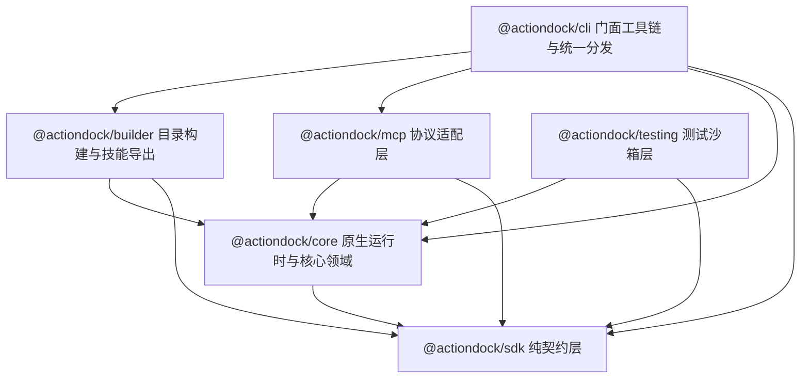
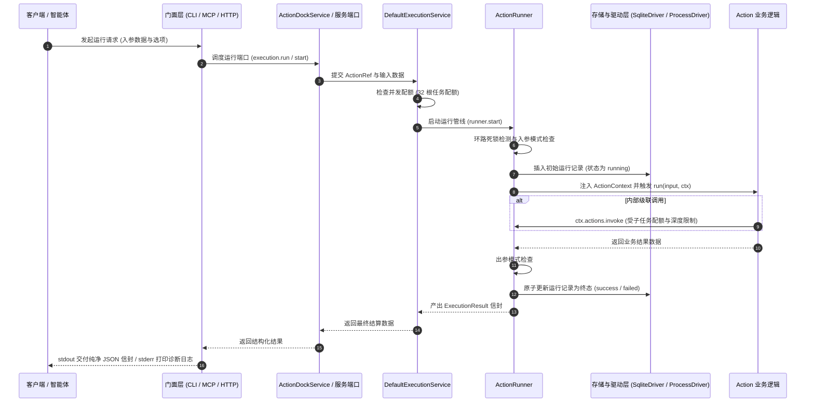
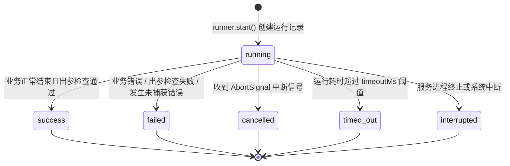

# 底层架构：Runtime 运行引擎与分层架构

ActionDock 围绕运行确定性、类型安全与环境解耦构建。
系统支持 CLI、MCP、HTTP、测试沙箱与目录构建多种调用形态。
所有调用形式均收敛至统一的运行语义。

---

## 架构总览与 6 个核心子包体系

ActionDock 采用分层解耦架构设计。
整个体系划分为 6 个职责单一的核心子包：



- `@actiondock/sdk`：纯契约层。该包零生产依赖，导出 `defineAction`、`ActionContext`、`ProcessAPI`、`Logger`、`Config` 与 `StateStore`，提供 `createStreamDecoder` 等受管进程辅助工具。
- `@actiondock/core`：原生运行时与核心领域。包含包图发现、动作目录、调用治理与运行主链。提供 `NodeSqliteDriver`、`NodeProcessDriver` 与 `NodeHttpServer` 原生驱动。提供标准服务端口与统一服务门面。
- `@actiondock/builder`：构建规划与分发构建包。负责依赖规划、模板创建与规程渲染。支持 Node.js 目录产物构建、npm 打包与 Skill 资产导出。
- `@actiondock/mcp`：MCP 协议适配层。对接核心层标准服务端口，将 Action 映射为 MCP 工具。支持 STDIO 与 HTTP 通道以及取消信号链路。
- `@actiondock/cli`：命令行门面与运行分发器。提供统一的 `ad` 命令行工具与标准信封输出。
- `@actiondock/testing`：确定性测试沙箱框架。提供 `createTestRuntime` 测试运行时、`FakeClock` 虚拟时钟、`FakeProcessDriver` 进程驱动桩、`MockProcessExecutor` 与 `MemoryStorage`。

---

## 统一运行主链

ActionDock 内部采用统一的运行主链通道。
无论是 CLI、MCP、HTTP 还是测试沙箱发起调用，均收敛至确定的流水线：

```text
Host -> Resolution -> PackageRuntime -> ExecutionService -> ActionRunner -> Action
```

- 宿主容器层（Host）：通过 `ActionDockHost` 或 `ActionDockService` 服务端口接收外部调用请求与入参数据。
- 动作解析层（Resolution）：领域函数 `resolveAction` 基于单一事实源完成动作寻址与消歧。全系统统一采用斜杠语法（`<package-id>/<action-id>`）。宿主结合调用方包的命名绑定配置解析物理目标。
- 包级装配层（PackageRuntime）：基于包图节点构建隔离的包级运行上下文与依赖环境。
- 协调层（ExecutionService）：`DefaultExecutionService` 统筹并发配额、追踪根调用与协同取消信号。
- 状态机层（ActionRunner）：驱动单一终态状态机。负责模式检查、循环依赖拦截与状态持久化。
- 业务运行层（Action）：运行开发者编写的业务逻辑并产出强类型结果。



---

## 动作命名绑定与多目标路由主链

ActionDock 支持将 Action 调用解耦为逻辑标识与物理拓扑映射。
路由机制深度内聚于宿主运行流中：

- 宿主装配与快照：宿主初始化装配阶段解析命名绑定配置与 Profile 远端连接。绑定配置来自 `.actiondock/bindings.json` 或 `createActionDock` 启动选项。系统完成快照冻结，运行期间保持静态确定性。
- 环境解析语义：Profile 连接始终在运行当前 Action 的宿主环境上解析。配置目标 `type: "local"` 对应当前宿主本身，而非发起 CLI 调用的客户端。
- 绑定查找与消歧：
  - 未传 binding 选项：系统仅检索 default 绑定。未配置 default 时保持宿主默认本地解析。
  - 显式传入 binding 选项：对应命名绑定不存在时，系统抛出 NOT_FOUND 错误。系统禁止隐式回退至 default 或本地目标。
- 跨节点远端运行：
  - 权限声明约束：跨节点目标包名相同时，也必须在清单中显式声明 uses 权限。远端宿主独立验证鉴权。
  - 契约模式一致性：本地存在同名 Action 参照时，远端契约模式必须与本地完全一致，否则阻断运行。若无本地同名参照，则按远端实际契约模式运行。
  - 远端下游依赖解析：远端 Action 触发的级联调用，其后续依赖由远端宿主环境与配置解析。
- 分布式边界说明：
  - 协作式取消边界：取消属于协作请求。网络断链或超时导致远端状态未知时，系统抛出 SERVICE_RESULT_UNKNOWN 错误。
  - 链路追踪范围：每次远端子调用创建独立 requestId 并记录远端运行标识。系统不复用父任务请求标识，不保证全局去重。
  - 治理边界限制：框架不承诺跨远端服务内联调用栈追踪。框架不提供全局并发配额治理与分布式事务保证。

更多详情参见 [动作命名绑定与路由机制](/developer/action-bindings.md)。

---

## 统一服务门面与标准服务端口

ActionDock 解耦上层适配与底层实现。
系统通过标准服务端口与统一门面屏蔽底层实体细节：

### 统一服务门面

顶层工厂函数屏蔽本地与远程拓扑差异：

- 本地服务门面 `createActionDock`：创建本地 `ActionDockService` 实例。在当前 Node.js 进程内装配原生运行时驱动并运行。支持通过 `actionBindings` 选项在内存中覆盖动作命名绑定，支持动态拓扑装配。
- 远端服务门面 `connectActionDock`：创建远端 `ActionDockService` 实例。通过 HTTP 协议与远端服务通信。支持鉴权令牌、请求超时控制与证书安全检查。

### 五大标准服务端口

系统将对外能力解耦为五大标准服务端口契约：

- 发现端口 `DiscoveryPort`：负责包与动作的元数据发现、清单检索、全文过滤与规程查询。
- 运行端口 `ExecutionPort`：负责动作的同步阻塞运行（`run`）与异步启动运行（`start`）。
- 任务记录端口 `RunsPort`：负责任务运行历史列表、单次详情查询与协同取消（`cancel`）。列表与详情读取支持取消信号中止。
- 配置端口 `ConfigPort`：负责运行时分层配置读取、持久化配置修改与环境变量检查。
- 状态端口 `StatePort`：负责包级与动作级持久化键值存取、前缀列举与过期清理。

---

## 单一事实源体系

ActionDock 贯彻单一事实源设计，杜绝各模块私自实现短名搜索或猜测：

- 包图发现单一事实源 `PackageDiscovery`：自顶向下扫描工作区与全局注册表，创建包目录索引。
- 包拓扑图单一事实源 `PackageGraph`：维护包节点身份标识、实例版本与拓扑依赖关系。
- 动作目录单一事实源 `ActionCatalog`：统一聚合索引所有已加载包的动作元数据，提供确定的多维检索能力。
- 动作解析单一事实源 `resolveAction`：作为全系统动作引用的唯一解析函数。优先支持包限定斜杠语法（`<package-id>/<action-id>`）与当前调用方包匹配。系统禁止冒号历史语法（`pkg:action`）。
- 调用治理策略单一事实源 `InvocationPolicy`：统筹管理根任务最大并发配额（默认 32）。统筹管理子任务并发上限（默认 64）与最大嵌套深度（默认 16）。

---

## SDK 纯契约层：零基础设施依赖

`@actiondock/sdk` 是面向 Action 编写者的纯契约层，设计遵循以下规范：

- 零外部运行时依赖：该包依赖列表为空，不引入外部运行时库或底层设施。
- 纯粹契约与抽象定义：仅导出类型定义与基础辅助声明函数。导出内容包含 `defineAction`、`ActionContext`、`ProcessAPI`、`Logger`、`Config`、`StateStore` 与运行结果信封结构。
- 杜绝依赖污染：业务 Action 仅需依赖 `@actiondock/sdk`。业务代码保持极小体积与可移植性，免受底层驱动或工具链升级影响。

---

## Core 原生运行时驱动体系

Node 原生运行时能力内聚归并入 `@actiondock/core`，基于 Node.js 原生特性构建驱动：

- 同步存储驱动 `NodeSqliteDriver`：基于内置模块 `node:sqlite`（`DatabaseSync`）构建。满足同步驱动契约。默认开启预写日志模式（WAL）、外键约束检查与忙等待超时（`busy_timeout = 5000`）。
- 受管进程平台驱动 `NodeProcessDriver`：实现 Core 层的 `ProcessDriver` 契约。提供基于 `node:child_process` 的管道隔离与 PTY 伪终端支持。标准输入输出物理隔离，结合独立进程组与跨平台信号精准管理子进程。支持 POSIX 负数 PID 与 Windows 进程树，杜绝孤儿进程。支持输入终止 `inputEOF` 与输出排空。保留 `NodeProcessExecutor` 兼容运行简单命令。
- 原生模块加载器 `NodeModuleLoader`：基于 Node.js 现代模块解析机制加载 Action 源码。原生支持 TypeScript 类型擦除与 ESM 规范，免除前置编译等待。
- 原生网络服务容器 `NodeHttpServer`：基于原生 `node:http` 实现。将底层请求与响应转化为标准 Web Request 与 Response 规范。通过 Web Streams 实现流式数据传输与管道转发。

---

## 数据目录排他租约锁与崩溃自愈机制

为防止多个宿主进程并发操作同一数据目录损坏数据库，Core 层维护 `.actiondock.data.lock` 排他锁文件：

- 排他锁元数据：锁文件记录宿主 PID、主机名、会话令牌、创建时间与关联子进程列表（`childPids`）。
- 活跃进程冲突防护（`DATA_DIR_IN_USE`）：检测到锁文件存在且持有进程存活时，系统抛出 `DATA_DIR_IN_USE` 错误。系统拒绝并发启动，保障数据单写安全。
- 孤儿进程保护（`DATA_DIR_RECOVERY_REQUIRED`）：旧宿主进程已死亡但关联子进程存活时，抛出 `DATA_DIR_RECOVERY_REQUIRED` 错误。系统阻止脏写并等待子进程回收。
- 崩溃自动恢复：旧宿主进程与所有子进程均已死亡时，当前宿主自动接管排他锁并清理残留会话。系统实现无需人工介入的错误自愈。
- 遗留运行收敛的保守收割：接管数据目录时，非当前宿主遗留的非终态记录在确认死亡后收敛为 `interrupted`。判定依据优先采用进程探测。若记录登记的宿主 `hostPid` 明确不存在，系统才收割记录。权限受限时视为存活。无进程标识的遗留记录以心跳时间戳兜底。心跳超过宽限期时才收割。两类依据均不可靠时系统保守保留，不误杀活跃任务。

---

## 测试沙箱层：`@actiondock/testing` 与生产 Runner 的复用

传统 Mock 方案容易脱离真实运行逻辑。
ActionDock 坚持复用生产 Runner 逻辑：

- 全内存测试驱动：`createTestRuntime` 提供全套内存驱动：
  - `MemoryStorage`：内存模拟 SQLite 行为，支持配置、状态与运行记录存储。
  - `FakeClock`：支持手动推进毫秒级时间的模拟时钟。
  - `FakeProcessDriver`：支持模拟输出、退出、排空关闭与错误注入的进程驱动桩。
  - `MockProcessExecutor`：支持拦截、断言与预设输出的模拟进程运行器。
  - `TestEventSink`：捕获生命周期事件并支持历史追溯。
- 复用核心运行器：沙箱内部直接实例化真实的 `ActionRunner`。入参出参模式检查、调用死锁检测、状态机流转与记录落库在测试中真实运行。测试环境与生产环境语义完全一致。

---

## 核心运行引擎：`ActionRunner` 唯一生命周期与状态机

所有 Action 调用均收敛至唯一的核心运行引擎：`ActionRunner`。



### 运行生命周期全流程

- 解析 Action 动作定义：定位目标 Action，合并全局配置、环境变量与项目级配置。
- 调用环路死锁检测：维护运行调用栈。检测到动作递归调用自身时立即阻断。系统返回错误码 `ACTION_CALL_CYCLE`。
- 入参模式严格检查：基于 Ajv 验证器检查输入数据。不满足 `inputSchema` 约束时，立即返回错误码 `INPUT_VALIDATION_FAILED`。
- 记录初始化并落库：在存储引擎中创建运行记录，初始状态标记为 `running`。
- 构建运行时上下文：组装注入 `RuntimeConfig`、`RuntimeStateStore`、`ProcessAPI`、`Logger`、级联调用器与 `AbortSignal`。
- 取消信号与超时竞态：初始化 AbortController 与定时器。业务函数与取消超时 Promise 竞态。
- 出参模式严格检查：Action 运行完成后检查 `outputSchema`。检查失败则判定任务失败。
- 终态转移与结果持久化：推动状态机转移至确定终态，原子写入 SQLite 运行记录表。

### 单一终态状态机规范

- 状态不可逆转移：运行记录从初始态 `running` 开始。记录只能转移至 `success`、`failed`、`cancelled`、`timed_out`、`interrupted` 终态之一。
- 终态不可修改：任务进入终态后记录立即冻结。系统禁止二次状态修改或重复结算，杜绝状态悬挂与数据竞争。

### 协作式取消机制

- 信号传递：客户端断开连接、调用方主动取消或任务超时触发时，引擎触发 `ctx.signal`。
- 下游协作响应：Action 运行长耗时操作时，将 `ctx.signal` 透传至底层操作。底层操作感知信号后立即中止。系统释放连接与进程资源，防止孤儿任务空转。

---

## 统一协调中心：`DefaultExecutionService` 与并发配额管控

`DefaultExecutionService` 是面向多任务并发调度的协调入口。
服务集中管理活跃运行任务、事件分发与安全配额：

### 三重并发配额防护机制

- 32 根任务并发上限：限制服务实例内活跃独立根任务不超过 32 个。达到上限时系统拒绝新任务，返回配额已满错误，防止并发击垮内存与数据库。
- 64 子任务并发限制：单个根任务通过 `ctx.actions.invoke` 发起的活跃子任务上限默认为 64，防止并行任务放大。
- 16 层调用深度限制：Action 级联调用嵌套深度默认上限为 16 层。此限制防范深层嵌套耗尽资源与调用栈溢出。

### 优雅停机保证

服务接收到关闭信号时，协调服务按序收尾：
- 立即将服务标记为关闭状态，拒绝接收新任务提交。
- 向所有活跃任务的句柄广播取消信号，通知业务协作退出。
- 在配置的宽限期内等待存量任务安全结束并完成数据持久化。

---

## 标准输出与错误通道的物理隔离

面向智能体与自动化系统构建工具链时，输出污染会导致模型解析崩溃。
ActionDock 在底层严格划分通信通道的职责边界：

- 标准输出通道（stdout）：专供机器可读数据交付。在机器模式下仅输出格式规范的 JSON 信封，不掺杂 ANSI 控制字符或调试文本。
- 标准错误通道（stderr）：专供排错与诊断。承载所有业务日志（`ctx.log`）、进度指示器与错误堆栈。
- 子进程物理管道隔离：底层进程运行器派生外部子进程时配置 `stdio: ["pipe", "pipe", "pipe"]`。该配置切断子进程与宿主标准流的贯通，外部命令输出无法溢出至宿主标准输出。
